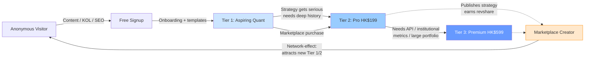
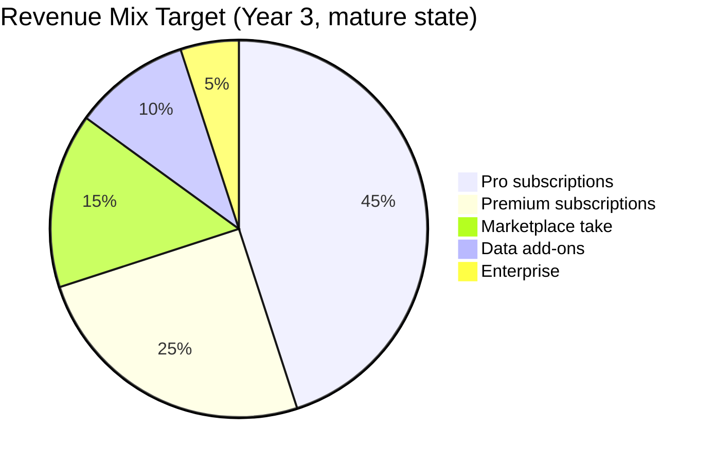
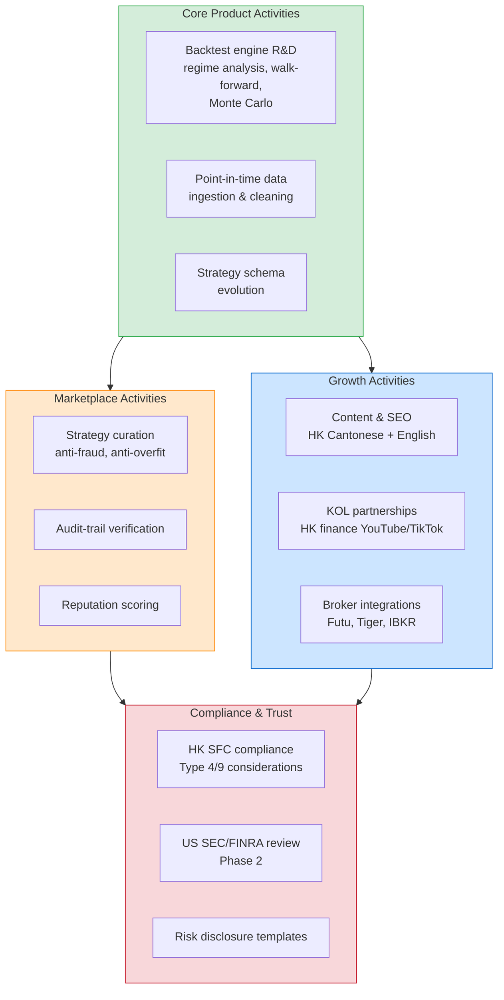
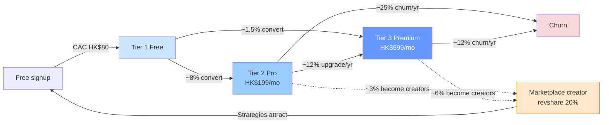

# Business Model Canvas — Retail Backtesting Fintech SaaS

> **Working name:** _Backtest.io_ (placeholder) — a retail-first, multi-market backtesting SaaS with an embedded strategy marketplace.
>
> **Tagline:** _"Institutional-grade backtesting at retail price — from Hong Kong outward."_
>
> **Companion docs:** [CONCEPT.md](./CONCEPT.md) · [STRATEGY_DEFINITION.md](./STRATEGY_DEFINITION.md) · [FSM_ARCHITECTURE.md](./FSM_ARCHITECTURE.md)

---

## 1. Canvas at a Glance

The nine standard Business Model Canvas blocks, arranged in the canonical Osterwalder layout:

```mermaid
block-beta
  columns 10
  block:KP:2
    columns 1
    KPTitle["<b>KEY PARTNERS</b>"]
    KPBody["HKEX & US data vendors<br/>(Refinitiv, Polygon, Intrinio)<br/>Brokers: Futu, Tiger,<br/>IBKR HK → Schwab, IBKR US<br/>Cloud: AWS HK + US<br/>SFC/SEC compliance counsel<br/>Influencer & education channels<br/>(CFA HK, HKSI, YouTube quants)"]
  end
  block:KAR:2
    columns 1
    KA["<b>KEY ACTIVITIES</b><br/>Backtest engine R&D<br/>Point-in-time data ingestion<br/>Marketplace curation<br/>Compliance & audit trails<br/>Community growth"]
    KR["<b>KEY RESOURCES</b><br/>Proprietary engine (FSM)<br/>Point-in-time data lake<br/>Strategy schema IP<br/>Quant + fintech team<br/>SFC-licensed officer<br/>Marketplace network"]
  end
  block:VP:2
    columns 1
    VPTitle["<b>VALUE PROPOSITIONS</b>"]
    VPBody["No-code → full-code strategy builder<br/>HK + US universes, point-in-time<br/>Survivorship-bias-free data<br/>Institutional metrics<br/>(Sharpe, Sortino, Calmar)<br/>Regime + walk-forward analysis<br/>Marketplace: buy/sell strategies<br/>Compliance-grade audit trail<br/>Local fluency (HKD, H-shares, FPS)"]
  end
  block:CRCH:2
    columns 1
    CR["<b>CUSTOMER RELATIONSHIPS</b><br/>Self-serve onboarding<br/>Templates & education<br/>Community (Discord, leaderboards)<br/>Premium success for Tier 3<br/>Marketplace reputation system"]
    CH["<b>CHANNELS</b><br/>Web app + mobile companion<br/>Strategy marketplace<br/>SEO / YouTube / TikTok<br/>HK Cantonese KOL partnerships<br/>Broker deep-link integrations<br/>Education & certification funnel"]
  end
  block:CS:2
    columns 1
    CSTitle["<b>CUSTOMER SEGMENTS</b>"]
    CSBody["<b>Tier 1 — Aspiring Quant</b><br/>(Free / Starter)<br/>Learning systematic investing<br/><br/><b>Tier 2 — Active DIY Trader</b><br/>(Pro)<br/>Self-directed strategy designers<br/><br/><b>Tier 3 — Affluent Investor</b><br/>(Premium)<br/>Portfolio-rule validators"]
  end
  block:COST:5
    columns 1
    COSTTitle["<b>COST STRUCTURE</b>"]
    COSTBody["Market data licensing (HKEX + US feeds) — largest COGS · Cloud compute (backtest workloads) · Engineering payroll · Compliance & legal (SFC HK, US counsel) · Customer acquisition (paid + KOL) · Payment processing (Stripe, AlipayHK, FPS) · Marketplace fraud/anti-overfit detection"]
  end
  block:REV:5
    columns 1
    REVTitle["<b>REVENUE STREAMS</b>"]
    REVBody["Subscription tiers (MRR): Free / Pro HK$199 (~US$25) / Premium HK$599 (~US$75) · Marketplace take rate (20% on strategy sales & creator subs) · Premium data add-ons (HK$99/mo each) · Annual plans (15% discount, lifts LTV) · Enterprise licensing (brokers, FAs) — Phase 2"]
  end
  style KPTitle fill:#FFE8CC,stroke:#FF8C00,stroke-width:2px
  style VPTitle fill:#D4EDDA,stroke:#28A745,stroke-width:2px
  style CSTitle fill:#CCE5FF,stroke:#0066CC,stroke-width:2px
  style COSTTitle fill:#F8D7DA,stroke:#C82333,stroke-width:2px
  style REVTitle fill:#FFF3CD,stroke:#FFC107,stroke-width:2px
```

---

## 2. Customer Segments — Tiered Retail

Three distinct retail personas served on a single platform with tier-gated capability.

### Tier 1 — Aspiring Quant (Starter / Free)

| Attribute                   | Detail                                                                                                                                                        |
| --------------------------- | ------------------------------------------------------------------------------------------------------------------------------------------------------------- |
| **Profile**                 | Retail investor, 22–40, intellectually curious, learning systematic investing. Often a recent graduate, junior professional, or career-switcher.              |
| **HK persona**              | "Investing-club member at UST / CUHK / HKU; reads Bloomberg, follows local KOLs on YouTube."                                                                  |
| **US persona later**        | "Reddit r/algotrading lurker; just finished Andrew Ng's course; wants something more rigorous than TradingView Pine Script."                                  |
| **Job-to-be-done**          | "Help me learn whether systematic investing actually works — without losing money proving it."                                                                |
| **Pain points**             | Existing tools are either too simplistic (TradingView) or too coding-heavy (QuantConnect, Backtrader). Education is fragmented across YouTube, books, Medium. |
| **Willingness to pay**      | Low at first; converts to Pro once they have a strategy worth running deeply.                                                                                 |
| **Acquisition cost target** | < HK$80 (mostly organic / content-led).                                                                                                                       |

### Tier 2 — Active DIY Trader (Pro)

| Attribute                   | Detail                                                                                                                                           |
| --------------------------- | ------------------------------------------------------------------------------------------------------------------------------------------------ |
| **Profile**                 | Self-directed retail trader, 28–55, already trades actively through Futu / Tiger / IBKR. Owns or wants to own a systematic edge.                 |
| **HK persona**              | "Mid-career professional in finance, tech, or law; trades HK + US after work; runs ~5 strategies."                                               |
| **US persona later**        | "Power user of Composer / TrendSpider / QuantConnect; frustrated by either oversimplified no-code or steep Python learning curve."               |
| **Job-to-be-done**          | "Help me design, validate, and confidently deploy my own strategies across HK + US markets."                                                     |
| **Pain points**             | No tool spans HK and US with equal data quality. Overfitting fear. Lack of regime analysis. Manual reproducibility of past backtests is painful. |
| **Willingness to pay**      | HK$199–HK$599 / month. High LTV.                                                                                                                 |
| **Acquisition cost target** | < HK$400 (paid + KOL + organic mix). Payback < 6 months.                                                                                         |

### Tier 3 — Affluent Long-Term Investor (Premium)

| Attribute                   | Detail                                                                                                                                                         |
| --------------------------- | -------------------------------------------------------------------------------------------------------------------------------------------------------------- |
| **Profile**                 | Mass-affluent investor (HK$2M+ liquid net worth), 40–65. Less interested in day trading; deeply interested in validating portfolio rules.                      |
| **HK persona**              | "Family office principal or senior executive; runs a multi-currency equities portfolio; uses backtests to justify allocation decisions before family council." |
| **US persona later**        | "RIA-managed investor who wants to second-guess their advisor; or DIY long-term investor running factor tilts."                                                |
| **Job-to-be-done**          | "Help me prove — to myself, my family, or my advisor — that this portfolio rule is robust before I commit material capital."                                   |
| **Pain points**             | Existing institutional tools (FactSet, Bloomberg PORT) are gated and expensive. Retail tools lack the rigor. No bridge between the two.                        |
| **Willingness to pay**      | HK$599 / month and up. Highest LTV, lowest churn. Will pay for premium data add-ons.                                                                           |
| **Acquisition cost target** | < HK$1,200. Long payback acceptable given LTV/CAC > 5 target.                                                                                                  |

### Tier Progression Funnel

---

## 3. Value Propositions

Five anchored value propositions, ranked by differentiation.

### VP1 — Multi-Market, Point-in-Time, Survivorship-Bias-Free

The single most important technical promise. Every universe defined in [STRATEGY_DEFINITION.md §1.3](./STRATEGY_DEFINITION.md) is delivered with:

- **Point-in-time membership** — S&P 500 components as of any historical date, not today's roster.
- **Delisted-stock retention** — every stock that left an index is still in the historical universe.
- **Point-in-time fundamentals** — financial data is keyed to the filing release date, not the reporting period.

This is what separates this product from TradingView, Excel-driven backtests, and most retail tools. It is also the most expensive thing to build.

### VP2 — No-Code → Low-Code → Full-Code Continuum

A single strategy schema (see [STRATEGY_DEFINITION.md §7](./STRATEGY_DEFINITION.md)) is editable in three modes:

| Mode          | Audience        | Editor                                                                          |
| ------------- | --------------- | ------------------------------------------------------------------------------- |
| **No-code**   | Tier 1          | Form-based strategy builder; dropdowns for indicators, sliders for thresholds.  |
| **Low-code**  | Tier 2          | Visual block editor + inline expressions (`RSI(14) < 35 AND Close > SMA(200)`). |
| **Full-code** | Tier 2 + Tier 3 | Python SDK; same schema serialised to/from code.                                |

A strategy designed in any mode can be opened, modified, and run in any other. This avoids the trap of QuantConnect (code-only) and Composer (no-code-only).

### VP3 — Institutional Metrics, Retail Price

Every backtest produces the full metric battery from [CONCEPT.md §HOW.5](./CONCEPT.md): return, risk, risk-adjusted, and trade-quality metrics, plus regime breakdown and walk-forward validation. Pricing puts it within Tier 2 reach.

### VP4 — Embedded Strategy Marketplace

Validated strategies can be published. Marketplace listings carry a mandatory **compliance-grade audit trail** (every backtest reproducible, version-pinned, point-in-time data hash recorded), discouraging the overfit "5,000% backtest" listings that plague retail forums.

- **Buyers:** Tier 1 + Tier 2 (browse, subscribe to creators, copy strategies into their workspace).
- **Sellers:** Tier 2 + Tier 3 + external quants (publish strategies, earn revshare).
- **Take rate:** 20% on all strategy sales and creator subscriptions.

### VP5 — Local Fluency (HK-First Differentiator)

What sets this apart from Composer, TrendSpider, QuantConnect at HK launch:

- HKD-denominated pricing and accounting.
- H-shares, dual-listed stocks, and HK ETFs are first-class citizens (not a US-product afterthought).
- Hang Seng family of indices supported at parity with S&P/Nasdaq.
- FPS, AlipayHK, and Octopus payment rails.
- Cantonese + English UI.
- SFC-aware risk disclosures and "past performance" warnings.

---

## 4. Channels

### Direct Channels

| Channel                       | Purpose                                            | Cost profile   |
| ----------------------------- | -------------------------------------------------- | -------------- |
| **Web app** (SaaS self-serve) | Primary product surface                            | Sunk           |
| **Mobile companion app**      | Monitor backtests, get alerts, browse marketplace  | Sunk           |
| **Strategy marketplace**      | Discovery + monetisation surface; itself a channel | Network effect |
| **Public API** (Premium)      | Tier 3 / developer-led growth                      | Sunk           |

### Acquisition Channels

| Channel                       | HK launch                                                          | US later                                                   |
| ----------------------------- | ------------------------------------------------------------------ | ---------------------------------------------------------- |
| **SEO content**               | Cantonese + English how-to articles, strategy templates            | English long-tail, dominant by US launch                   |
| **YouTube**                   | HK Cantonese quant KOLs (e.g. small-cap creators in finance space) | English quant YouTube (PyQuant, Quantopian alumni network) |
| **TikTok / 小紅書 / IG**      | Short-form strategy walkthroughs in Cantonese                      | English educational shorts                                 |
| **Broker deep-links**         | Futu (富途), Tiger Brokers, IBKR HK referral integrations          | Schwab, IBKR US, eToro                                     |
| **Education / Certification** | CFA Institute HK, HKSI, university investment clubs                | CFA Institute US, FRM, online courses                      |
| **Community / Discord**       | HK-focused server, marketplace leaderboards                        | Global server, English                                     |
| **Paid search**               | Google Ads on HK trading keywords                                  | Google Ads US                                              |

### Retention Channels

In-app strategy alerts, weekly backtest digest email, marketplace activity notifications, and quarterly "regime report" content piece.

---

## 5. Customer Relationships

| Relationship                      | Tier    | Mechanism                                                                                      |
| --------------------------------- | ------- | ---------------------------------------------------------------------------------------------- |
| **Self-serve onboarding**         | All     | Guided 5-minute strategy template walkthrough at signup                                        |
| **Education**                     | T1      | In-product courses; "Backtesting 101" → "Avoiding Overfitting" → "Walk-Forward Validation"     |
| **Community-driven support**      | T1 + T2 | Discord, in-app forum, marketplace creator threads                                             |
| **Premium customer success**      | T3      | Named CSM, quarterly strategy review, white-glove onboarding                                   |
| **Marketplace reputation system** | All     | Public creator scorecards (Sharpe history, walk-forward pass rate, audit-trail completeness)   |
| **Compliance helpdesk**           | All     | Built-in risk disclosure templates; SFC-aligned warnings; data export for tax / record-keeping |

The marketplace is itself the deepest relationship lever — creators and consumers become a network whose value compounds with scale.

---

## 6. Revenue Streams

### Subscription Tiers (Primary — MRR)

| Tier               | Price (HKD/mo) | USD equivalent | What's included                                                                                                                |
| ------------------ | -------------- | -------------- | ------------------------------------------------------------------------------------------------------------------------------ |
| **Free / Starter** | HK$0           | —              | 1 universe (Hang Seng OR S&P 500), 1-year history, 3 concurrent backtests, basic metrics, marketplace browse                   |
| **Pro**            | HK$199         | ~US$25         | All universes (HK + US), 10-year history, unlimited backtests, all metrics, walk-forward, regime analysis, marketplace publish |
| **Premium**        | HK$599         | ~US$75         | Everything in Pro + tick-resolution data, API access, custom universes, premium fundamental data, priority compute, named CSM  |

Annual plans available at 15% discount (12 months billed up-front), targeted at improving LTV and reducing churn-risk volatility.

### Marketplace (Secondary — Transaction)

| Stream                        | Take Rate | Notes                                                                                         |
| ----------------------------- | --------- | --------------------------------------------------------------------------------------------- |
| **Strategy one-time sale**    | 20%       | Buyer pays creator-set price; platform takes 20%; SFC compliance review for high-fee listings |
| **Creator subscription**      | 20%       | Recurring sub to a creator's published strategy stream                                        |
| **Premium listing placement** | Fixed fee | Curated "Editor's Picks" slots; quarterly fee                                                 |

### Data Add-Ons (Tertiary — MRR)

| Add-on                                 | Price     | Audience                                     |
| -------------------------------------- | --------- | -------------------------------------------- |
| **Alternative data pack**              | HK$99/mo  | Tier 2 + Tier 3                              |
| **Deep fundamentals** (>10y, restated) | HK$149/mo | Tier 3                                       |
| **Tick-resolution intraday**           | HK$199/mo | Tier 2 + Tier 3 (active intraday strategies) |

### Enterprise (Phase 2 — Q3 2027+)

White-label licenses to HK / US brokers, FAs, family offices, and university finance programmes. Pricing custom; expected ACV HK$120K–HK$1.2M.

### Revenue Mix Targets

---

## 7. Key Resources

| Resource                        | Type               | Why it matters                                                                      | Build vs Buy                                                      |
| ------------------------------- | ------------------ | ----------------------------------------------------------------------------------- | ----------------------------------------------------------------- |
| **Backtest engine** (FSM-based) | IP                 | Core moat; reproducibility, regime analysis, walk-forward live here                 | Build (per [FSM_ARCHITECTURE.md](./FSM_ARCHITECTURE.md))          |
| **Point-in-time data lake**     | Data               | Survivorship-bias-free is the single biggest retail differentiator                  | Build pipeline; license raw feeds                                 |
| **Strategy schema IP**          | IP                 | Single source of truth; portable across no-code / low-code / full-code              | Build (per [STRATEGY_DEFINITION.md §7](./STRATEGY_DEFINITION.md)) |
| **Cloud infrastructure**        | Physical           | Compute-elastic backtest engine; HK + US regions for data residency                 | Buy (AWS HK + US)                                                 |
| **Quant + fintech team**        | Human              | Domain credibility, engine R&D, compliance navigation                               | Hire (3 quants, 6 engineers, 1 compliance, 1 CSM at launch)       |
| **SFC-licensed officer**        | Human / regulatory | Required to legally operate marketplace and provide "performance information" in HK | Hire (Type 4 / Type 9 RO)                                         |
| **Marketplace network**         | Network effect     | The compounding moat; harder to replicate than the engine itself                    | Cultivate (creator partnerships at launch)                        |
| **Brand & community**           | Intangible         | Trust is non-trivial in fintech; community is retention                             | Build (Discord, content, KOL partnerships)                        |

---

## 8. Key Activities

---

## 9. Key Partnerships

### Data Partners (Critical)

| Partner                        | Coverage                                | Notes                               |
| ------------------------------ | --------------------------------------- | ----------------------------------- |
| **HKEX (Hong Kong Exchanges)** | HK equities, indices, corporate actions | Direct license — required at launch |
| **Refinitiv / LSEG**           | HK + US fundamentals                    | Cross-market fundamentals           |
| **Polygon.io**                 | US equities tick + EOD                  | Cost-efficient US data              |
| **Intrinio**                   | US fundamentals, alternative data       | Premium tier supply                 |
| **FactSet** (Phase 2)          | Institutional-grade fundamentals        | Once Premium tier ARPU justifies    |

### Broker / Distribution Partners

| Partner                    | Geography    | Role                                                         |
| -------------------------- | ------------ | ------------------------------------------------------------ |
| **Futu Securities (富途)** | HK + US      | Largest HK retail broker by app users; deep-link entry point |
| **Tiger Brokers**          | HK + US      | Second-largest HK retail broker; younger demo                |
| **Interactive Brokers HK** | HK + US      | Sophisticated retail, RIA-adjacent                           |
| **Schwab / IBKR US**       | US (Phase 2) | US launch distribution                                       |

### Infrastructure & Payment Partners

| Partner                         | Role                             |
| ------------------------------- | -------------------------------- |
| **AWS (HK + US regions)**       | Cloud — data residency compliant |
| **Stripe**                      | Card payments (HK + US)          |
| **AlipayHK / WeChat Pay HK**    | Local HK wallet rails            |
| **FPS (Faster Payment System)** | HK instant bank transfer         |

### Compliance & Trust

| Partner                        | Role                                                      |
| ------------------------------ | --------------------------------------------------------- |
| **SFC liaison counsel**        | HK regulatory navigation (Type 4 / Type 9 considerations) |
| **US legal counsel** (Phase 2) | SEC, FINRA, state-level review pre-US launch              |
| **Audit firm (Big 4 tier)**    | SOC 2, data-handling attestation                          |

### Distribution & Education

| Partner                         | Role                                                   |
| ------------------------------- | ------------------------------------------------------ |
| **HK Cantonese finance KOLs**   | Top-of-funnel; lower CAC than paid search              |
| **CFA Institute HK / HKSI**     | Credibility, course funnel, certification co-marketing |
| **University investment clubs** | HKU, CUHK, UST, PolyU — Tier 1 acquisition pipeline    |

---

## 10. Cost Structure

### Fixed Costs (monthly run-rate at launch, HKD)

| Item                                         | Estimate (HK$ / mo) | Notes                                |
| -------------------------------------------- | ------------------- | ------------------------------------ |
| Engineering payroll (6 eng + 3 quant + 1 PM) | 850,000             | Senior-weighted HK comp              |
| Compliance & legal                           | 80,000              | Counsel retainer + SFC officer share |
| Cloud baseline                               | 60,000              | Pre-load AWS HK + US                 |
| Office / G&A                                 | 50,000              | Co-working or small office           |
| **Subtotal fixed**                           | **~1,040,000**      | ~US$133K/mo                          |

### Variable Costs

| Item                       | Driver                                    | Notes                                                 |
| -------------------------- | ----------------------------------------- | ----------------------------------------------------- |
| **Market data licensing**  | Subscriber count + tier mix               | Largest single COGS; HKEX + US feeds scale with users |
| **Backtest compute**       | Active paid users × deep-backtest minutes | Elastic AWS; cap per tier                             |
| **Customer acquisition**   | New paid signups                          | Target CAC < HK$400 (Pro), < HK$1,200 (Premium)       |
| **Payment processing**     | Gross revenue                             | ~2.5–3% blended (Stripe / AlipayHK / FPS)             |
| **Marketplace operations** | Marketplace GMV                           | Fraud detection, dispute resolution                   |

### Unit Economics (Year 2 target, blended)

| Metric                    | Target                                          |
| ------------------------- | ----------------------------------------------- |
| **Gross margin**          | > 70% (subscription) / > 80% (marketplace take) |
| **CAC payback**           | < 12 months blended; < 6 months for Pro         |
| **LTV / CAC**             | > 3.0 blended; > 5.0 for Premium                |
| **Annual churn**          | < 30% Pro; < 15% Premium                        |
| **Net revenue retention** | > 105% (driven by tier upgrades + add-ons)      |

---

## 11. Strategic Assumptions & Risks

The canvas above depends on five load-bearing assumptions that should be tested early in the pitch.

| #   | Assumption                                                                                             | How we'd test it                                                  | Risk if wrong                                                  |
| --- | ------------------------------------------------------------------------------------------------------ | ----------------------------------------------------------------- | -------------------------------------------------------------- |
| 1   | HK retail will pay HK$199/mo for a serious backtesting tool when free alternatives exist               | Pre-launch landing page + waitlist; 100 design-partner interviews | Compress pricing to HK$99; lower margin                        |
| 2   | Point-in-time HK data can be licensed and ingested at sustainable cost                                 | HKEX + Refinitiv quotes during incorporation                      | COGS pressure; may need to launch US-first instead             |
| 3   | Marketplace network effect kicks in by month 12 (i.e. > 200 active creators)                           | Seed creator programme; 20 paid creator slots at launch           | Marketplace remains thin; falls back to pure subscription play |
| 4   | SFC will tolerate marketplace + performance display under Type 4 / Type 9 framing                      | Pre-launch SFC consultation via counsel                           | May need to delay marketplace; subscription-only launch first  |
| 5   | US expansion in Year 2 is feasible against entrenched incumbents (QuantConnect, Composer, TrendSpider) | HK ARR trajectory + US user research before commitment            | Stay HK-dominant; pursue APAC expansion (SG, TW) instead       |

---

## 12. How This Canvas Maps to Existing Architecture

| Canvas Block                                      | Source / Anchor                                                                                                       |
| ------------------------------------------------- | --------------------------------------------------------------------------------------------------------------------- |
| Value Prop: institutional metrics                 | [CONCEPT.md §HOW.5 — Evaluate Performance Metrics](./CONCEPT.md)                                                      |
| Value Prop: regime + walk-forward                 | [CONCEPT.md §HOW.7 — Benchmark and Regime Analysis](./CONCEPT.md)                                                     |
| Value Prop: point-in-time, survivorship-bias-free | [CONCEPT.md §Limitations — Survivorship Bias](./CONCEPT.md) + [STRATEGY_DEFINITION.md §1.4](./STRATEGY_DEFINITION.md) |
| Value Prop: no-code → full-code schema            | [STRATEGY_DEFINITION.md §7 — Structured Strategy Object](./STRATEGY_DEFINITION.md)                                    |
| Key Resource: backtest engine                     | [FSM_ARCHITECTURE.md](./FSM_ARCHITECTURE.md)                                                                          |
| Customer Segments: HK + US universes              | [STRATEGY_DEFINITION.md §1.3 — Supported Universes](./STRATEGY_DEFINITION.md)                                         |
| Revenue: marketplace audit-trail                  | [CONCEPT.md §WHEN — regulatory/institutional review](./CONCEPT.md)                                                    |

---

## 13. One-Slide Summary (for Pitch Deck)

> **What:** A multi-market backtesting SaaS with an embedded strategy marketplace, built for retail investors who deserve institutional-grade rigor.
>
> **Who:** Three tiered retail segments — aspiring quants (Free), active DIY traders (Pro HK$199/mo), and affluent investors (Premium HK$599/mo).
>
> **Where:** Hong Kong first — underserved, technically demanding, and home turf. United States in Year 2.
>
> **Why now:** Retail trading volume in HK and US is at historic highs; existing tools force a binary choice between toy-grade (TradingView) and developer-grade (QuantConnect). Point-in-time data costs have come down enough that survivorship-bias-free retail product is finally viable.
>
> **The moat:** Proprietary point-in-time data + FSM-based reproducible backtest engine + a strategy marketplace whose value compounds with creators.
>
> **The ask:** [TBD by founder] — used for HK launch (data licensing, compliance, seed creator programme, first 12 months of payroll).
