# Enterprise Architecture — Backtesting Fintech SaaS

> **Companion docs:** [CONCEPT.md](./CONCEPT.md) · [STRATEGY_DEFINITION.md](./STRATEGY_DEFINITION.md) · [BUSINESS_CANVAS.md](./BUSINESS_CANVAS.md) · [VALUE_STREAM.md](./VALUE_STREAM.md) · [FSM_ARCHITECTURE.md](./FSM_ARCHITECTURE.md)
>
> **Framework:** TOGAF 10 — four architecture domains (Business, Data, Application, Technology) — combined with BIZBOK business capability decomposition, adapted from the reference banking enterprise capability canvas.
>
> **Reference example:** The supplied banking enterprise canvas is the structural template — five horizontal layers stacked under a channels row, with Product/Service Management decomposed by line of business. This document re-applies that exact pattern to a retail backtesting SaaS.

---

## 1. Framework, Scope, and Reading Order

### 1.1 What This Document Is

This is the **target-state enterprise architecture** for a retail-focused backtesting fintech SaaS launching in Hong Kong, expanding to the United States in Wave 2. It is the load-bearing reference that everything below the C-suite — engineering, product, compliance, finance, operations — should align to.

### 1.2 Architectural Domains (TOGAF)

| Domain | What It Defines | Section |
|---|---|---|
| **Business Architecture** | What the enterprise does — capabilities, value streams, organizational units, operating model | §2 |
| **Data Architecture** | What data the enterprise manages — domains, master records, flows, governance | §4 |
| **Application Architecture** | What systems realize capabilities — portfolio, integration, lifecycle | §3 |
| **Technology Architecture** | What infrastructure runs the systems — compute, network, security, regions | §5 |

### 1.3 How This Reuses the Banking Reference

The banking enterprise canvas shown in the user reference is a **Business Capability Model (BCM)** in BIZBOK form, with five horizontal layers under a channels row. The structural mapping for our SaaS:

| Banking Reference Layer | Our SaaS Equivalent | Key Re-Interpretation |
|---|---|---|
| Channels (Browser, ATM/Kiosk, B2B, POS, FAX, etc.) | Web App, Mobile App, API, Marketplace, Broker Deep-Links, Community | Drop physical channels (ATM, POS, FAX); add digital-native channels (API, Marketplace, Discord) |
| Customer Value Management | Customer Value Management | Same intent — different sub-capabilities (KOL Partnerships replaces Campaign Mgmt) |
| Customer Sales & Service Management | Customer Sales & Service Management | Same intent — Onboarding/KYC scaled to SaaS-level (subscription) not bank-level (KYC for credit) |
| Product/Service Management (one column per LoB) | Product/Service Management (one column per Service Domain) | Banking LoBs (Deposits, Cards, Trade Finance) replaced by SaaS Service Domains (Backtest Engine, Marketplace, Data Services, etc.) |
| Shared Operational Services | Shared Operational Services | Re-cast: Payments → Subscription Billing; Treasury Ops → Compute Orchestration; MDM → Strategy/Market Data MDM |
| Business Support Functions (HR, Legal, IT Ops) | Business Support Functions | Largely preserved — every enterprise has these |

---

## 2. Business Architecture

### 2.1 Capability Map — Master Canvas

The full enterprise capability map, organized in five layers under a channels row. Capabilities in **bold** are differentiating (the moat); regular weight are strategic; italic are commodity (table stakes).

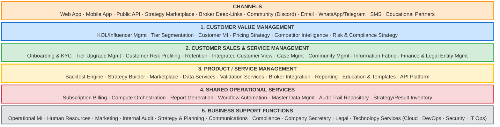

Sections 2.2–2.7 expand each row.

---

### 2.2 Layer 0 — Channels

These are the **delivery channels** by which value reaches the customer. Each is a contact point that must be designed, instrumented, and operated.

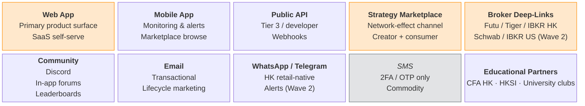

| Channel | Realization | Differentiation |
|---|---|---|
| **Web App** | **SvelteKit + TypeScript** (hybrid SSR + SPA), Tailwind | Primary; sunk cost. SvelteKit's compiled output gives smaller bundles than React for the same UX, which matters on HK mobile networks. |
| **Mobile App** | **Flutter / Dart** (single codebase iOS + Android) | Companion, not standalone. Flutter chosen over React Native for consistent rendering and tighter performance on chart-heavy screens. |
| **Public API** | REST + Webhooks, OAuth2 | **Differentiating** — most retail tools have no API |
| **Strategy Marketplace** | Embedded in Web App, surfaced as separate channel | **Differentiating** — network effect |
| **Broker Deep-Links** | OAuth + deep-link protocols (Futu Open API, Tiger API, IBKR Client Portal) | **Differentiating in HK** — Futu/Tiger integration is non-trivial |
| **Community** | Discord (hosted) + in-app discussion | Strategic for retention |
| **Email** | Transactional via Postmark; lifecycle via Customer.io | Commodity |
| **WhatsApp / Telegram** | WhatsApp Business API; Telegram Bot API | HK retail-native; differentiates from US-only products |
| **SMS** | Twilio (2FA / OTP only) | Commodity |
| **Educational Partners** | Co-branded content; certification co-marketing | Strategic — credibility builder |

---

### 2.3 Layer 1 — Customer Value Management

The "go-to-market machinery." Maps to the banking reference's Customer Value Management block.

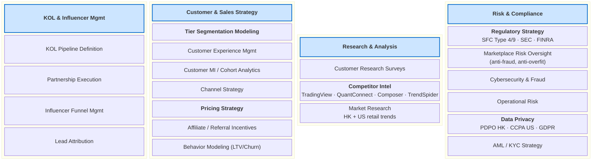

**Notable substitutions vs the banking reference:**

| Banking Capability | Our Equivalent | Why |
|---|---|---|
| Campaign Definition & Oversight | KOL Pipeline Definition | Retail SaaS growth is KOL-led, not campaign-led, in HK |
| Lead Management | Influencer Funnel Mgmt | Same intent, different funnel topology |
| Customer Segmentation Modelling | Tier Segmentation Modeling | Three explicit tiers (T1/T2/T3) replaces banking's many-axis segmentation |
| Retail Credit Risk / Wholesale Credit Risk | _Not applicable_ | We don't extend credit |
| Insurance Risk | _Not applicable_ | We don't underwrite |
| — | **Marketplace Risk Oversight** | New capability — banks don't have a strategy-publishing marketplace |

---

### 2.4 Layer 2 — Customer Sales & Service Management

The "customer lifecycle machinery." Where customers are onboarded, served, retained, and (sometimes) churned with dignity.

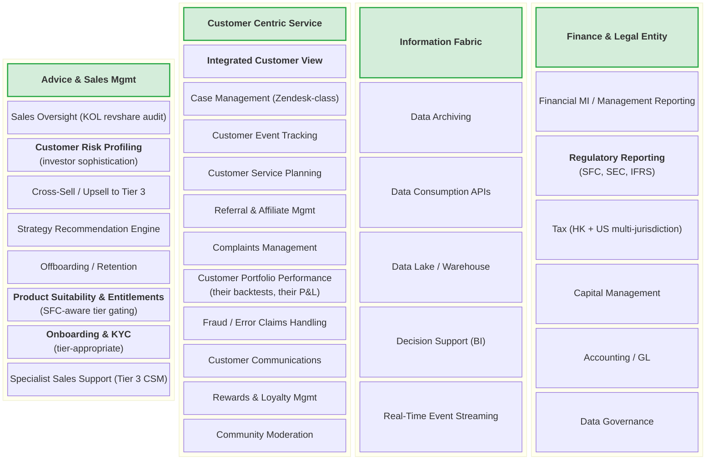

**Notable substitutions vs the banking reference:**

| Banking Capability | Our Equivalent | Why |
|---|---|---|
| Customer Onboarding & KYC | Onboarding & KYC (tier-appropriate) | SaaS-level KYC for Free/Pro; full AML KYC for Marketplace sellers and Premium tier |
| Credit Approval | _Not applicable_ | We don't extend credit |
| Customer Portfolio Performance | Customer Portfolio Performance (their backtests) | Re-interpret: their saved strategies + result history |
| Financial/Wealth Planning | Strategy Recommendation Engine | We recommend strategies, not financial plans (and add disclosure to that effect) |

---

### 2.5 Layer 3 — Product / Service Management

The **core operational heart** of the SaaS — analogous to the banking reference's wide row with one column per line of business (Deposits, Cards, Lending, etc.). Here, each column is a **Service Domain** that delivers value across the [VALUE_STREAM.md](./VALUE_STREAM.md) stages.

The cross-cutting **Product & Proposition Strategy** column (left-most) sets the strategy for the entire row, exactly as in the banking reference.

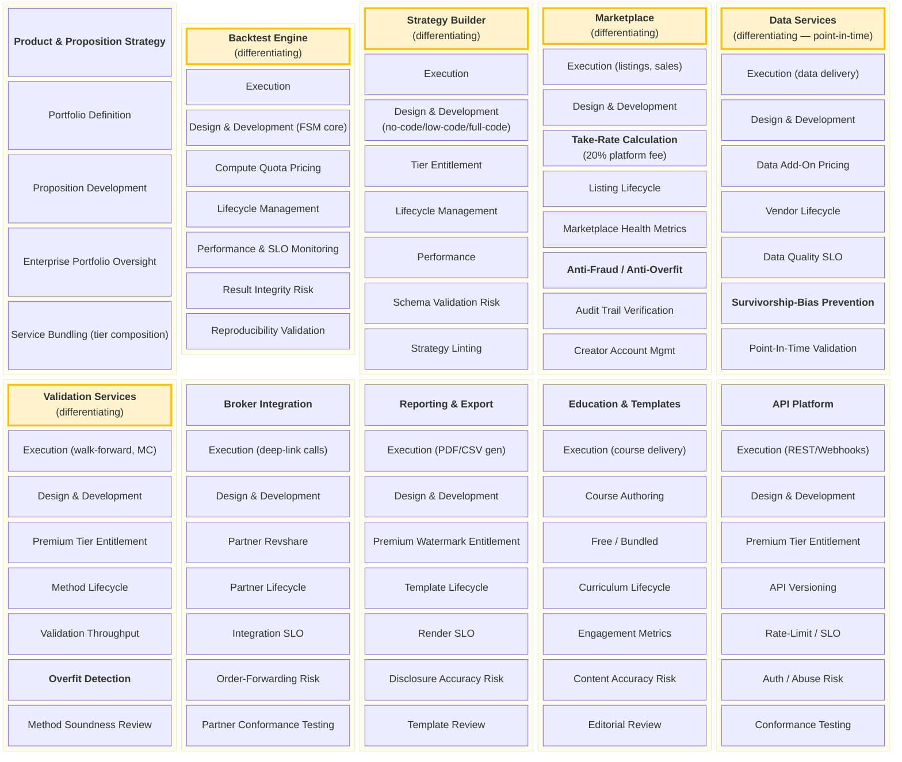

**The pattern from the banking reference is preserved exactly:** each Service Domain column has the same nine sub-capabilities (Execution, Design & Development, Fee Calculation, Lifecycle, Performance & Oversight, Risk Mgmt, QA/Credit-Approval-equivalent, Pricing, Account Mgmt). The header colors mark the five differentiating domains that form the moat.

| Banking Reference LoB Column | Our Service Domain | Why this mapping |
|---|---|---|
| Deposits, Cards, Secured Lending, Unsecured Lending | _Not applicable_ — we hold no money | — |
| Trade Finance, Asset Mgmt, Payments & FX, Insurance | _Not applicable_ | — |
| Funds Accounting, Funds Distribution | _Not applicable_ | — |
| Private Client | _Conceptually maps to_ → Premium Tier CSM (lives in §2.4 instead) | — |
| Portfolio Management Services | **Strategy Builder + Validation Services** | The closest analog in a backtest SaaS |
| _New_ | **Backtest Engine** | The core compute capability |
| _New_ | **Marketplace** | Network-effect monetization |
| _New_ | **Data Services** | Point-in-time data is the moat |
| _New_ | **Broker Integration** | Closes the loop to live trading |
| _New_ | **Education & Templates** | Tier 1 acquisition funnel |
| _New_ | **API Platform** | Tier 3 power user enablement |

---

### 2.6 Layer 4 — Shared Operational Services

The cross-cutting **operational utilities** — analogous to the banking reference's Shared Processing, MDM, and Inventories & Valuations row.

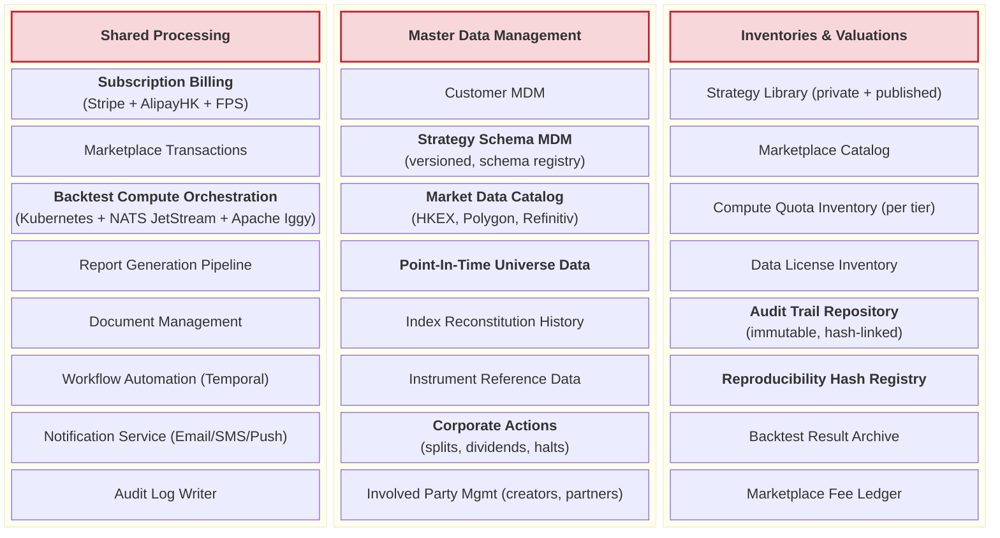

**Notable substitutions vs the banking reference:**

| Banking Capability | Our Equivalent | Why |
|---|---|---|
| Payments, Reconciliation Operations | Subscription Billing, Marketplace Transactions | Stripe + AlipayHK + FPS instead of SWIFT/RTGS |
| Collections & Recovery | Dunning / Failed-Payment Recovery | Same concept, much smaller in scale |
| Treasury Operations | Compute Orchestration | Treasury manages cash; we manage compute |
| Physical Cash/Inventory Services | _Not applicable_ — no physical | — |
| Workflow Management | Workflow Automation (Temporal) | Same concept |
| Customer Data Mgmt, Common Data Mgmt | Customer MDM | Same |
| Market Data Mgmt & Distribution | **Market Data Catalog + Point-In-Time Universe + Corporate Actions** | Expanded — these are differentiating capabilities for us |
| Instrument Data Mgmt | Instrument Reference Data | Same |
| Involved Party Mgmt | Involved Party Mgmt (creators, partners, brokers) | Same |
| Cash Accounting, Commodities Position, etc. | _Not applicable_ | — |
| Securities Custody, Funds Holdings, Safe Keeping | **Audit Trail Repo + Result Archive + Reproducibility Hash Registry** | The "valuables we hold" are audit hashes and result archives, not securities |

---

### 2.7 Layer 5 — Business Support Functions

The "back office of the back office" — preserved largely intact from the banking reference, with the technology subdivision adapted to a cloud-native fintech SaaS.

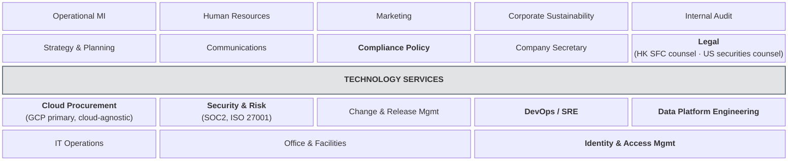

---

### 2.8 Capability-to-Value-Stream Mapping

Every capability exists to serve one or more value-stream stages from [VALUE_STREAM.md](./VALUE_STREAM.md). This table makes the mapping explicit — the foundation for impact analysis, prioritization, and capability investment decisions.

| Value Stream Stage | Primary Capabilities | Supporting Capabilities |
|---|---|---|
| **1. Discover & Onboard** | KOL Mgmt, Marketing, Tier Segmentation, Onboarding & KYC | Channels, Identity & Access Mgmt, Education |
| **2. Define Strategy** | Strategy Builder, Strategy Schema MDM, Education & Templates | Marketplace (browse to clone) |
| **3. Configure Simulation** | Strategy Builder, Compute Quota Inventory | Cost Model engine (part of Engine) |
| **4. Select Universe & Data** | Data Services, Point-In-Time Universe Data, Corporate Actions, Index Reconstitution, Instrument Ref Data | Market Data Catalog, Data License Inventory |
| **5. Execute Backtest** | Backtest Engine, Compute Orchestration, Result Archive | Reproducibility Hash Registry, Audit Log Writer |
| **6. Evaluate Performance** | Backtest Engine (metrics), Reporting & Export | Information Fabric, Customer Portfolio Performance |
| **7. Inspect Trade Log & Regime** | Backtest Engine (drill-down), Information Fabric | Data Services (regime data) |
| **8. Iterate & Validate** | Validation Services (walk-forward, MC), Backtest Engine | Compute Orchestration, Quota Mgmt |
| **9. Publish or Deploy** | Marketplace, Broker Integration, Audit Trail Repo, Take-Rate Calc | Reputation Mgmt, Reporting & Export, Compliance Policy |

---

### 2.9 Capability Heat Map — Differentiating vs Strategic vs Commodity

Every capability sits in one of three buckets — this drives **build vs buy** decisions and **investment prioritization**.

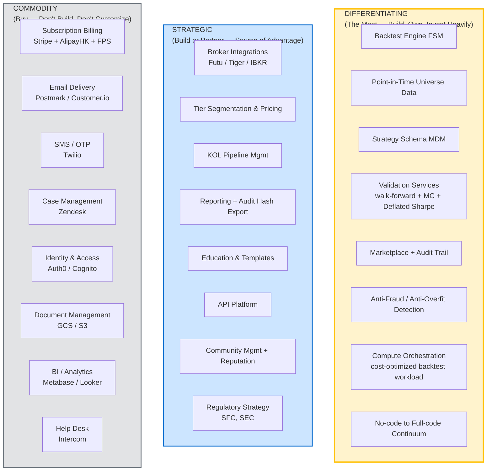

**The build-vs-buy heuristic:** Differentiating capabilities are built and owned end-to-end. Strategic capabilities can be built or partnered, but the IP and customer relationship stay with us. Commodity capabilities are bought — no exception — because building them creates negative ROI through opportunity cost.

---

## 3. Application Architecture

### 3.1 Application Portfolio (Target State)

Each application realizes one or more capabilities. Status:
- **CORE** = differentiating, built in-house
- **PARTNER** = strategic, built but uses SaaS components heavily
- **BUY** = commodity, purchased

| # | Application | Capabilities Realized | Status | Tech Choice |
|---|---|---|---|---|
| A1 | **Backtest Engine** | Engine Execution, FSM Core, Reproducibility Validation | CORE | **Rust** core (hot-loop bar iterator, indicators, fills) + **Python** orchestration shell (NumPy / Polars / pandas for I/O glue, exposed via PyO3 bindings) |
| A2 | **Strategy Builder UI** | Strategy Builder Execution + Design | CORE | **SvelteKit + TypeScript** (SSR + SPA hybrid), Tailwind, deployed as static + edge-rendered |
| A3 | **Python SDK** | Strategy Builder full-code mode, API Platform consumption | CORE | **Python** package on PyPI (typed; uses the same Rust engine bindings as A1) |
| A4 | **Strategy Marketplace** | Marketplace Execution, Take-Rate Calc, Creator Account Mgmt | CORE | **SvelteKit** front-end + **Go** backend (Fiber / Echo) + Postgres + Stripe Connect |
| A5 | **Data Lake & Point-in-Time Service** | Data Services, Point-In-Time Universe, Corporate Actions | CORE | **Object store** (GCS primary, S3 portable) + Apache Iceberg + Parquet · **Rust** point-in-time query service (DataFusion / Polars) for engine reads · **Python** batch ingestion (Airflow + dbt) · **Apache Iggy** real-time tick stream for live-data ingest path |
| A6 | **Validation Service** | Walk-Forward, Monte Carlo, Overfit Detection | CORE | **Python** orchestration + **Rust** compute kernels for Monte Carlo and parameter sweeps (via Rayon parallelism + PyO3) |
| A7 | **Compute Orchestrator** | Backtest Compute Orchestration, Quota Mgmt | CORE | **Go** control plane (high-concurrency, low GC) · Kubernetes (GKE primary, EKS/AKS portable) · **NATS JetStream** durable job queue · KEDA autoscaler driven by JetStream consumer lag · backtest progress events published to **Apache Iggy** for real-time UI updates |
| A8 | **Audit Trail Service** | Audit Trail Repo, Reproducibility Hash Registry | CORE | **Go** API + Postgres (append-only schema) + **WORM object store** (GCS Bucket Lock primary, S3 Object Lock portable) + BLAKE3 hash chain · audit events shipped via **Apache Iggy** to downstream consumers (compliance, analytics) |
| A9 | **Broker Integration Hub** | Broker Integration capability | PARTNER | **Go** per-broker adapter services (Futu Open API, Tiger Open API, IBKR Client Portal) — Go chosen for concurrency and low-latency network handling |
| A10 | **Reporting Service** | Reporting & Export | CORE | **Go** PDF/CSV/Excel generator (using `gofpdf` / `excelize`) + signed audit-hash chain · headless Chromium for HTML→PDF fallback |
| A11 | **Subscription Billing** | Subscription Billing | BUY | Stripe (cards) + AlipayHK + FPS gateway · thin **Go** webhook receiver + reconciliation worker |
| A12 | **Identity & Auth** | IAM, Channel Auth | BUY | Auth0 (OIDC) · **Go** auth-edge service for tier-claim enforcement |
| A13 | **Support & CRM** | Case Mgmt, Customer Communications | BUY | Intercom + HubSpot · **Node.js** webhook integrator (chosen because both vendors ship best-in-class TypeScript SDKs) |
| A14 | **Email & Lifecycle Marketing** | Email Channel | BUY | Postmark (transactional) + Customer.io (lifecycle) — vendor-hosted, no language footprint we operate |
| A15 | **BI / Analytics** | Information Fabric, Customer MI | BUY | Metabase Cloud (vendor-hosted SaaS; we operate no JVM) on Snowflake |
| A16 | **Data Warehouse** | Data Repository, Decision Support | PARTNER | Snowflake (HK + US regions) · **Python** dbt jobs for transformations |
| A17 | **Education Platform** | Education & Templates capability | PARTNER | **SvelteKit** front-end + **Node.js** content backend (Strapi headless CMS) + Mux for video |
| A18 | **Community** | Community channel | BUY | Discord (vendor) + Discourse Cloud (vendor) — no on-prem operation |
| A19 | **Notification Service** | Notification fan-out (Email / Push / WhatsApp / SMS / in-app real-time) | PARTNER | **Go** notification dispatcher subscribes to **NATS JetStream** subjects, fans out to Postmark, Twilio, Firebase, WhatsApp Business API · in-app real-time updates pushed via **Apache Iggy** to SvelteKit clients over WebSocket/SSE |
| A20 | **Observability Stack** | DevOps/SRE | BUY | Datadog + Sentry + Grafana Cloud — fully managed |
| A_mobile | **Mobile App** _(channel)_ | Mobile App channel | PARTNER | **Flutter / Dart** (single codebase iOS + Android), Riverpod state mgmt, generated OpenAPI client |

### 3.2 Application-to-Capability Map

Rendered as **three focused Mermaid architecture diagrams** (`architecture-beta`) — one for each major runtime concern. A single combined diagram with all 20 applications becomes too dense to read; splitting by concern keeps each view readable while still surfacing the dependencies that matter.

**Reading guide (applies to all three):**
- `internet` icons are channel entry points; `server` icons are compute applications; `database` icons are stateful stores.
- Each edge is a primary runtime call path. Transitive and observability paths are omitted.
- The application IDs (A1 … A20) refer back to the portfolio table in §3.1.

---

#### View 1 — User Request Path

How a customer's backtest request flows from a channel through authentication and the Strategy Builder, through the Compute Orchestrator, into the Backtest Engine, and against the Point-in-Time Data Lake.

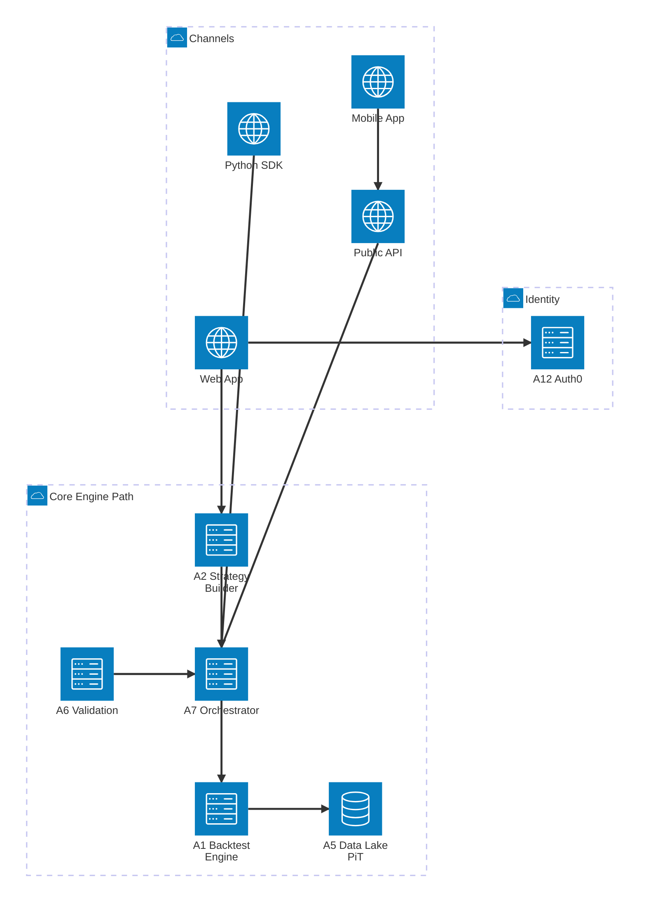

This view answers _"What happens when a customer presses Run Backtest?"_ — relevant to the Platform engineering team.

---

#### View 2 — Marketplace & Commerce Flow

How marketplace transactions, payment processing, audit-trail verification, and broker deployment are wired together. Authentication is shown here too because Broker Hub authenticates customers through the same Auth0 instance.

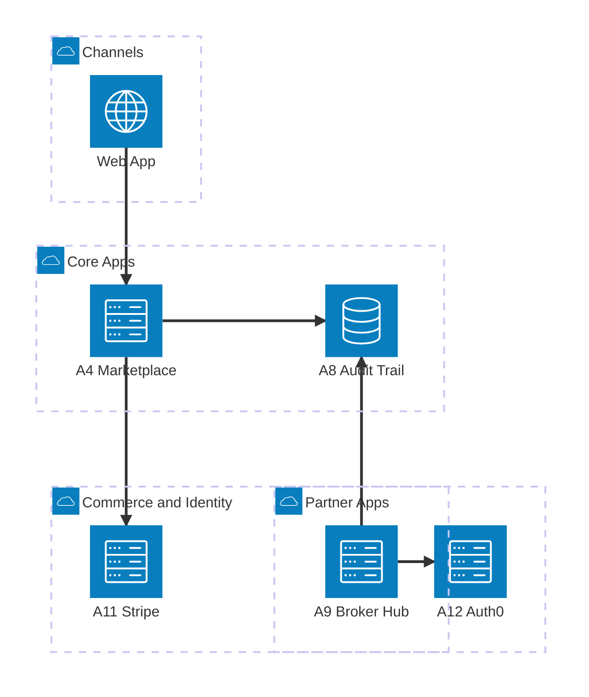

This view answers _"How does the marketplace make money and how do strategies get deployed to live brokers?"_ — relevant to the Marketplace and Partnerships teams.

---

#### View 3 — Result Fan-Out (Reporting, Warehouse, Notifications)

What happens after a backtest completes — fan-out to the Reporting service, the analytics Data Warehouse, customer Notifications, and the Audit Trail. Education content is wired into Notifications for guided learning campaigns.

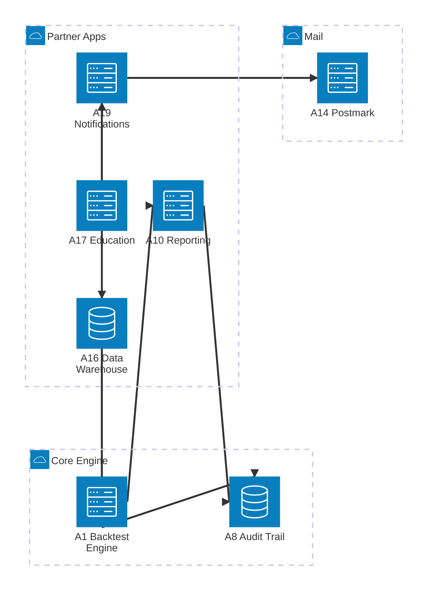

This view answers _"Where does my result go once the engine finishes?"_ — relevant to the Reporting/Data team.

---

A few applications from §3.1 are intentionally omitted from these three views because they are out-of-band:
- **A13 Intercom** (support) — invoked from Web App on user action, not part of the engine pipeline.
- **A15 Metabase** — read-only BI on the warehouse; not in any synchronous path.
- **A18 Discord / Discourse** (community) — federated, no compute integration.
- **A20 Datadog** (observability) — instruments everything as a sidecar; shows up in every path but adds visual noise.

They are part of the portfolio (§3.1 lists all twenty) but are deliberately excluded from these runtime views.

---

## 4. Data Architecture

### 4.1 Data Domains

Six business-aligned data domains. Each has an authoritative system of record.

| # | Data Domain | Master System | Examples | Data Owner |
|---|---|---|---|---|
| D1 | **Customer Data** | A12 Auth0 + Customer MDM | Identity, tier, preferences, KYC status | Head of Product |
| D2 | **Strategy Data** | A8 Audit Trail + Strategy Schema Registry | Strategy definitions, versions, parameter sets | Head of Engineering |
| D3 | **Market Data** | A5 Data Lake | Prices (HK + US), corporate actions, fundamentals, index membership | Head of Data |
| D4 | **Result Data** | A8 Audit Trail + A5 Data Lake | Backtest runs, trade logs, equity curves, regime breakdowns | Head of Engineering |
| D5 | **Marketplace Data** | A4 Marketplace | Listings, transactions, creator reputations, fees | Head of Marketplace |
| D6 | **Operational Data** | Various | Billing, support tickets, telemetry, audit logs | Head of Operations |

### 4.2 Master Data Management

Two MDM domains are **mission-critical** to the moat:

**Strategy Schema MDM** — every strategy version must be addressable by a globally unique, immutable hash. Schema evolution is governed by a strict semver policy; every schema change creates a new version, never mutates the prior one.

```
strategy_id: stra_01HZ2A...
versions:
  v1.0 [hash:7a3f...] frozen 2026-04-02
  v1.1 [hash:9b2e...] frozen 2026-04-15  (added trailing stop)
  v2.0 [hash:c4d1...] frozen 2026-05-08  (new signal type — breaking)
```

**Point-In-Time Market Data MDM** — every market data point is keyed by `(as_of_date, knowledge_date)` so a backtest dated 2018-06-01 sees only what was knowable at 2018-06-01:

| Field | Purpose |
|---|---|
| `as_of_date` | The economic date the value refers to (e.g. price on 2018-06-01) |
| `knowledge_date` | When the value first became publicly known (e.g. earnings released 2018-08-02) |
| `value` | The data point |
| `revision_seq` | If the value was later restated, the revision sequence number |

This single addition is the foundation of survivorship-bias-free, look-ahead-bias-free backtests.

### 4.3 Data Flow (High-Level)

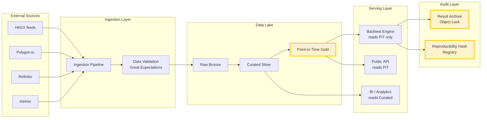

---

## 5. Technology Architecture

### 5.0 Language & Framework Standards

A short, deliberately opinionated set of rules. Every team must justify deviations in writing.

#### 5.0.1 Allowed Languages — by Tier

| Tier | Language | When to Choose | When **NOT** to Choose |
|---|---|---|---|
| **Tier 1 — Default backend** | **Go** | Network services, control planes, API gateways, orchestrators, integrations, fan-out workers, anything I/O-bound or concurrent | CPU-bound numerical kernels (use Rust); ML pipelines (use Python) |
| **Tier 1 — Default performance** | **Rust** | Hot-loop compute: backtest engine kernels, indicator math, point-in-time data scans, parallel Monte Carlo, parser-heavy code | Quick services with no perf need (use Go); rapid prototyping (use Python) |
| **Tier 2 — Specialized** | **Python** | ML, data engineering, batch ETL, scripting glue, the public SDK, anywhere the NumPy/Pandas/Polars/Sklearn ecosystem provides clear leverage | Anything I/O-concurrent (use Go); anything that needs single-binary deploy (use Go or Rust) |
| **Tier 2 — Specialized** | **Node.js / TypeScript** | Only when an integration target ships a best-in-class TypeScript SDK (e.g. Stripe, Intercom webhooks, Strapi CMS); BFF-layer for SvelteKit if a separate BFF is needed | New greenfield backend services (use Go) |

#### 5.0.2 Allowed Front-End Frameworks

| Surface | Framework | Notes |
|---|---|---|
| **Web** | **SvelteKit + TypeScript** | Single framework for all web surfaces (Strategy Builder, Marketplace, Education, Admin) |
| **Mobile** | **Flutter / Dart** | iOS + Android from one codebase; companion only, not standalone product |
| **Public API client (SDK)** | Python (primary), TypeScript (secondary) | Both auto-generated from the same OpenAPI spec |

#### 5.0.3 Explicit Exclusions

The following technologies are **not permitted** in any system we operate (vendor SaaS internally written in these is fine):

| Excluded | Reason |
|---|---|
| **Java / JVM-based runtimes** (Spring, Quarkus, Micronaut, Akka, Kotlin Server, Scala) | Operating cost (GC tuning, heap sizing, JVM-aware autoscaling), container density, slower cold-starts, larger team-skill investment, hiring market in HK is split |
| **.NET / C#** | Same operational rationale; smaller HK hiring market relative to Go/Python |
| **JVM-based data tools** (Kafka, Pulsar, Trino, Presto, Spark, Flink, ZooKeeper, Druid, Solr, Elasticsearch) | Avoid JVM tuning burden. Preferred substitutes: **NATS JetStream** (Go) for durable messaging and command queues — replaces Kafka for most cases; **Apache Iggy** (Rust) for high-throughput tick-level streaming where μs-class latency matters; DataFusion+Polars (Trino/Presto/Spark); Postgres-native solutions (ZooKeeper); Meilisearch or OpenSearch in vendor-managed mode (Elasticsearch). SQS/Kinesis remain available only as vendor-managed fallback when self-operation of NATS/Iggy is undesired. |
| **Ruby on Rails** | Not excluded for principled reasons but absent from this stack — no use case justifies adding another runtime |
| **PHP** | Same as Ruby |

#### 5.0.4 Selection Decision Tree

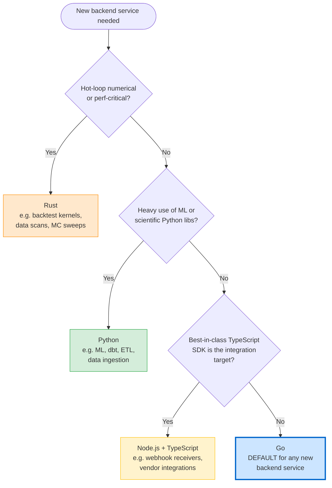

Go is the **default** — choosing anything else requires written justification on the PR.

---

### 5.1 Infrastructure Stack

All custom workloads run on language-appropriate compute. Operator policy: **no JVM and no .NET runtimes in any environment we maintain.**

Architectural principle (ADR-001 + ADR-016): every component below is consumed through a cloud-agnostic abstraction. The **GCP Primary** column is what we provision on day one; the **AWS Portable Alternative** column is what an identical OpenTofu apply produces on AWS if/when needed.

| Layer | Capability | GCP Primary (day one) | AWS Portable Alternative | Self-Hosted Cloud-Agnostic |
|---|---|---|---|---|
| **Cloud regions** | Compute / data residency | `asia-east2` (HK) primary · `us-central1` (US Wave 2) | `ap-east-1` (HK) · `us-east-1` (US) | n/a — pick a region |
| **Compute (web — SvelteKit)** | Static + edge SSR | Cloud CDN + GCS for static · **Cloud Run** for SSR | CloudFront + S3 · Lambda@Edge | Kubernetes Ingress + container |
| **Compute (Go services)** | Stateless services | **GKE Autopilot** with Distroless containers | EKS Fargate-profile or ECS Fargate | Any Kubernetes |
| **Compute (Rust+Python workers)** | Backtest worker pool | **GKE Standard** + cluster-autoscaler driven by NATS JetStream consumer lag | EKS + KEDA on SQS depth | Any Kubernetes + KEDA |
| **Compute (heavy validation)** | Monte Carlo / walk-forward | **GKE Spot node pool** + Rust+Rayon parallelism in-process | EKS Spot fleet + Rust+Rayon | Any Kubernetes Spot/preemptible |
| **Compute (Python data jobs)** | dbt / ETL / ML feature jobs | **Cloud Composer (managed Airflow)** or Prefect Cloud | MWAA (managed Airflow) or Prefect Cloud | Self-hosted Airflow on K8s |
| **Database (OLTP)** | Transactional | **Cloud SQL for PostgreSQL** (HA, read replicas, automated backups) | Aurora PostgreSQL | CloudNativePG operator on K8s |
| **Database (OLAP)** | Analytics warehouse | **Snowflake on GCP** (multi-region, native cross-cloud replication) | Snowflake on AWS | Self-hosted ClickHouse if Snowflake too expensive |
| **Data Lake** | Object-store-backed lakehouse | **GCS** + Apache Iceberg + Parquet · queried by Rust (DataFusion / Polars) | S3 + Iceberg + Parquet | MinIO + Iceberg |
| **Cache** | Hot path / sessions | **Memorystore for Redis** | ElastiCache for Redis | Redis on K8s |
| **Durable messaging (job queue, command bus)** | NATS JetStream (self-hosted, 3-node cluster per region, Go) | NATS JetStream on GKE | NATS JetStream on EKS | NATS JetStream on any K8s — **cloud-agnostic by construction** |
| **High-throughput streaming (ticks, real-time progress)** | Apache Iggy (self-hosted, Rust) | Iggy StatefulSet on GKE | Iggy StatefulSet on EKS | Iggy on any K8s — **cloud-agnostic by construction** |
| **Managed pub/sub (vendor fallback)** | Low-volume admin events | Cloud Pub/Sub | SQS + EventBridge | n/a — prefer NATS |
| **Object Storage (immutable audit)** | WORM / retention-locked | **GCS Bucket Lock** | S3 Object Lock | MinIO retention mode |
| **CDN** | Global edge | **Cloud CDN** | CloudFront | Bunny CDN / Fastly (vendor) |
| **Identity** | OIDC | Auth0 (vendor SaaS, multi-cloud by definition) | Auth0 | Keycloak self-hosted on K8s |
| **Secrets** | Application secrets | **Secret Manager (GCP)** with External Secrets Operator | AWS Secrets Manager via ESO | HashiCorp Vault on K8s |
| **Observability** | Logs / metrics / traces | Datadog + Sentry + Grafana Cloud (all vendor-hosted, cloud-portable) | same | same |
| **CI/CD** | Build + deploy | **GitHub Actions** + **ArgoCD** on GKE | GitHub Actions + ArgoCD on EKS | Any K8s |
| **IaC** | Infrastructure as code | **OpenTofu** (primary) + provider-modules abstraction layer | OpenTofu | OpenTofu (vendor-neutral) |
| **Service Mesh** _(if needed)_ | mTLS / traffic mgmt | Linkerd or Istio Ambient on GKE | same on EKS | same on any K8s |

The Kubernetes-everywhere choice (GKE on GCP, EKS on AWS, AKS on Azure) is what makes the workload abstraction practical. Every Go/Rust/Python/Node service ships as a container with a Helm chart or Kustomize overlay; only the OpenTofu provider definitions and bucket/region names change between clouds.

### 5.2 Multi-Region Topology (Wave 2)

Primary deployment is GCP (per ADR-001). The same OpenTofu codebase (per ADR-015) can render an AWS-equivalent topology — the diagram below uses GCP names but the structure is portable.

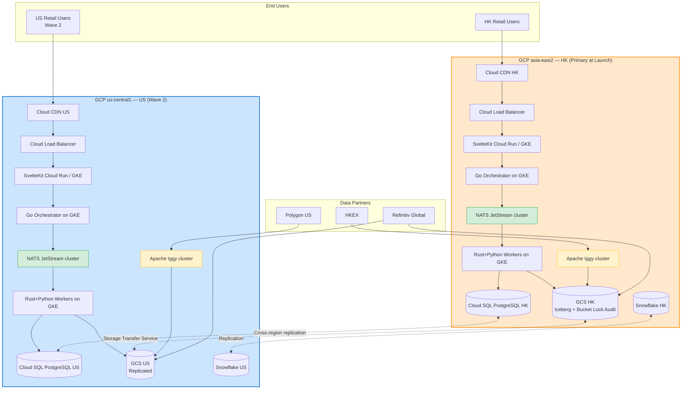

**Data residency rules:**
- HK customer data and audit trails are stored in `asia-east2` and replicated to `us-central1` for DR only — not for compute.
- US customer data is stored in `us-central1`.
- Market data is replicated bidirectionally for performance, with `as_of_date / knowledge_date` keys identical across regions.
- NATS JetStream and Apache Iggy run as in-region StatefulSets on GKE; cross-region replication is **not** enabled by default to keep blast-radius tight.

**Why the diagram is portable:** every named GCP primitive (Cloud CDN, Cloud Load Balancer, GKE, Cloud SQL, GCS, Cloud Pub/Sub) has a 1:1 AWS counterpart (CloudFront, ALB/NLB, EKS, Aurora, S3, SQS+EventBridge). The OpenTofu provider abstraction (per ADR-015 / ADR-016) handles the swap. NATS JetStream + Apache Iggy + Snowflake + Auth0 + Datadog are inherently multi-cloud and unchanged.

---

## 6. Cross-Cutting Concerns

### 6.1 Security & Compliance

| Concern | Capability / Application | Standard |
|---|---|---|
| **Data residency** | Multi-region topology | PDPO (HK), CCPA (US), GDPR (if EU users) |
| **Encryption at rest** | S3 SSE-KMS, RDS encryption | AES-256 |
| **Encryption in transit** | TLS 1.3 everywhere | — |
| **Authentication** | Auth0 (OIDC) + Go edge tier-enforcement | MFA enforced for Premium and creators |
| **Authorization** | RBAC + tier-based ABAC | Tier gating enforced at API layer (Go middleware) |
| **Audit logging** | A8 Audit Trail Service (Go + Postgres + S3 Object Lock) | Immutable, BLAKE3 hash-linked |
| **Vulnerability mgmt** | `govulncheck` (Go), `cargo audit` (Rust), Snyk, Dependabot, **GCP Security Command Center** (primary) / AWS Inspector (when on AWS) / Trivy in CI (cloud-agnostic) | Auto-merge low-risk patches |
| **SOC 2** | Achieve Type I by Wave 1 end, Type II by Wave 2 | Required for institutional customers |
| **SFC compliance** | Type 4 (advising on securities) consideration, Type 9 (asset mgmt) consideration | Counsel-led pre-launch determination |
| **AML / KYC** | Marketplace sellers + Premium tier KYC | Sumsub or Persona |

### 6.2 Service Level Objectives (SLO)

| Service | SLO | Justification |
|---|---|---|
| **Web App availability** | 99.9% monthly | Standard SaaS bar |
| **Backtest Engine — Pro tier** | P50 < 30s, P95 < 5min (10-year daily, single universe) | Customer expectation; Rust core makes this achievable |
| **Backtest Engine — Premium tier** | Priority queue: P50 < 15s, P95 < 2min | Justifies tier premium |
| **Marketplace API** | 99.95% — payment-coupled | Failures lose creator trust |
| **Data freshness (EOD)** | HKEX EOD by 17:30 HKT, US EOD by 22:00 ET | Customer expects "yesterday's data this morning" |
| **Audit trail durability** | 99.999999999% (11 nines, S3 Object Lock) | Compliance non-negotiable |

### 6.3 Observability

Three layers, instrumented at every capability boundary:

- **Logs** — structured JSON (Go: `zap` or `slog`; Rust: `tracing`; Python: `structlog`) to Datadog, retained 30 days hot / 365 days cold.
- **Metrics** — RED (Rate, Errors, Duration) on every API; USE (Utilization, Saturation, Errors) on every host.
- **Traces** — OpenTelemetry across Go / Rust / Python / Node services, sampled 1% baseline / 100% for errors.

---

## 7. Gap Analysis & MVP Scope

Greenfield build — current state is empty. The target state above is a multi-year vision. The MVP (Wave 1) is a deliberate subset.

### 7.1 Wave 1 — HK MVP (Months 0–9)

Capabilities **in scope** for Wave 1:

| Layer | Wave 1 Capabilities |
|---|---|
| **Channels** | Web App (SvelteKit), Email, Discord, SMS (auth only) |
| **Customer Value Mgmt** | KOL Pipeline, Tier Segmentation, Pricing, Competitor Intel, Regulatory Strategy |
| **Customer Sales & Service** | Onboarding (no KYC for Free/Pro), Tier Mgmt, Case Mgmt, Customer Portfolio, Info Fabric (basic) |
| **Product/Service** | Backtest Engine (Rust core, daily resolution, HK + US), Strategy Builder (no-code + low-code, SvelteKit), Data Services (10-year history), Validation Services (walk-forward basic), Reporting (Go PDF/CSV) |
| **Shared Operational** | Subscription Billing (Stripe + FPS), Compute Orchestration (Go), Strategy Schema MDM, Market Data Catalog, Point-In-Time Universe (HK + US), Audit Trail Repo (Go), Reproducibility Hash |
| **Business Support** | All BSF except Internal Audit (defer to Wave 2) |

Capabilities **deferred** to Wave 2 (Months 9–18):

| Layer | Wave 2 Additions |
|---|---|
| **Channels** | Mobile App (Flutter), Public API, WhatsApp/Telegram, broker deep-links (Futu) |
| **Product/Service** | Marketplace (full), Strategy Builder full-code (Python SDK), Validation Services (Monte Carlo + Deflated Sharpe via Rust+Rayon), Broker Integration (Go), API Platform |
| **Shared Operational** | Marketplace Transactions, Marketplace Fee Ledger, KYC for Marketplace sellers |

Capabilities **deferred** to Wave 3 (Months 18+):

| Layer | Wave 3 |
|---|---|
| **Geography** | US region launch, US data, US compliance |
| **Channels** | iOS/Android parity, Schwab/IBKR US deep-links |
| **Product/Service** | Tick-resolution data, Custom Rust indicators in user SDK, Premium Tier CSM scale-up, Enterprise licensing |
| **Shared Operational** | US Subscription Billing, US data residency |

### 7.2 Wave 1 Capability-by-Capability Build Plan

```mermaid
flowchart LR
    subgraph M0[Months 0-3<br/>Foundations]
        F1[Data Ingestion HK+US<br/>Python + Airflow]
        F2[Point-in-Time Engine<br/>Rust + DataFusion]
        F3[Auth + Billing<br/>Auth0 + Stripe + Go edge]
        F4[Strategy Schema v1<br/>Go + Postgres]
    end
    subgraph M3[Months 3-6<br/>Core Product]
        C1[Backtest Engine MVP<br/>Rust core]
        C2[Strategy Builder no-code<br/>SvelteKit]
        C3[Strategy Builder low-code<br/>SvelteKit]
        C4[Reporting PDF/CSV<br/>Go]
        C5[Audit Trail v1<br/>Go + Postgres + S3 ObjLock]
    end
    subgraph M6[Months 6-9<br/>Launch Prep]
        L1[Walk-Forward Validation<br/>Rust + Rayon]
        L2[Compliance Review SFC]
        L3[KOL Seed Programme]
        L4[Education Templates 50+]
        L5[Closed Beta with 100 users]
        L6[GA Launch HK]
    end

    M0 --> M3 --> M6
```

---

## 8. Architecture Decision Records (Headline)

Key decisions made in this document and the rationale. Each should later have its own ADR.

| # | Decision | Rationale | Alternative Considered |
|---|---|---|---|
| ADR-001 | **GCP default + cloud-agnostic by construction** | GCP `asia-east2` (HK) chosen as primary region; `us-central1` for US (Wave 2). However, no application or infrastructure component may depend on a cloud-vendor-specific primitive without an abstraction layer. Every workload runs on Kubernetes; storage is consumed through S3-compatible APIs (GCS interop or MinIO); managed PostgreSQL is treated as a commodity; NATS JetStream and Apache Iggy are self-hosted (already cloud-agnostic). Decision is to **minimise lock-in** while taking advantage of GCP's stronger HK data-residency, GKE maturity, and BigQuery/Vertex AI when ML use cases land. The stack must run on AWS or Azure within one engineering sprint if needed. | AWS-default (HK `ap-east-1` is the second-best HK story; data-egress costs higher); Azure (smallest HK fintech footprint of the three); multi-cloud-active (operating two clouds in parallel is premature at our scale) |
| ADR-002 | Rust-core engine with Python orchestration shell | Hot-loop performance lives in Rust (bar iteration, indicators, fills, parallel sweeps). Python is the orchestration / I/O shell exposed via PyO3. SDK consumers see Python; bottleneck code is Rust. | Pure Python (10–50× too slow); pure Rust (slower SDK ramp; ecosystem gap for ML/data); C++ (worse safety, slower iteration) |
| ADR-003 | Iceberg + Parquet on S3 (not native DB) | Engine-agnostic, cost-efficient, time-travel for point-in-time. Queried by Rust (DataFusion / Polars) and Python (PyIceberg) — explicitly **not** queried by JVM engines (Trino, Spark) | Snowflake-only (cost), Delta Lake (lock-in to Databricks), Trino/Spark (JVM operating burden) |
| ADR-004 | Stripe + AlipayHK + FPS for billing | HK retail expects local rails; Stripe alone is insufficient | Stripe-only (high HK friction) |
| ADR-005 | Auth0 over Cognito | Better DX, fewer landmines, faster to integrate | Cognito (cheaper but slower) |
| ADR-006 | Marketplace deferred to Wave 2 | Compliance review and seed creators take time; subscription-only launch first | Day-one marketplace (too risky for compliance) |
| ADR-007 | Mobile deferred to Wave 2 | Web covers HK retail at launch; mobile adds 3 months for marginal Wave 1 value | Day-one mobile (delays GA) |
| ADR-008 | Snowflake for warehouse, not Redshift | Multi-region replication and zero-copy clones are differentiating | Redshift (cheaper, more lock-in) |
| ADR-009 | Datadog over open-source observability | Time-to-value at our size; revisit at $5M ARR. Also: open-source alternatives (Elastic, Grafana self-hosted) are partly JVM, conflicting with ADR-011 | OSS stack (Prometheus+Grafana+Loki self-host — operating burden + partial JVM) |
| ADR-010 | Discord + Discourse hybrid for community | Discord for live chat, Discourse for searchable Q&A — both vendor-hosted | Discord-only (Q&A is poorly served) |
| **ADR-011** | **No Java/JVM and no .NET in any system we operate** | Hiring market in HK is increasingly Go/Python-centric for fintech startup roles; JVM operating burden (GC tuning, heap sizing, JVM-aware autoscaling, slow cold-starts, container density penalty) is not justified at our scale; Go gives 80% of what JVM provides at 20% of the ops overhead. **Vendor SaaS internally written on the JVM is fine** (Snowflake, Auth0, Metabase Cloud, Discourse Cloud) — we don't operate their runtimes. | Spring Boot stack (faster initial productivity, larger HK senior pool — but ongoing ops cost too high); Kotlin Server (still JVM); .NET 8 (smaller HK hiring pool) |
| **ADR-012** | **SvelteKit (web) + Flutter (mobile)** | SvelteKit: smaller bundles than React on HK mobile networks; compiled output; first-class TypeScript; SSR + SPA hybrid is the right shape for a SaaS dashboard. Flutter: single Dart codebase, consistent rendering across iOS/Android, performant chart rendering (Skia / Impeller) — important for a chart-heavy product | React+Next.js (larger ecosystem but bigger bundles); React Native (rendering quirks, less consistent UI); Vue/Nuxt (smaller HK community); native iOS+Android (2× engineering cost) |
| **ADR-013** | **Rust + Rayon replaces Ray/Spark for parallel validation** | Walk-forward and Monte Carlo are embarrassingly parallel — Rayon delivers this in-process with zero JVM dependency. Ray brings a Python-process supervisor model with operational overhead; Spark is JVM (violates ADR-011) | Ray (heavier ops, partial JVM in Spark integration); Dask (Python — fine but slower than Rust for our hot loops) |
| **ADR-014** | **NATS JetStream + Apache Iggy as the streaming spine** | Two-tier streaming. **NATS JetStream** (Go) for durable messaging, command bus, job queues, control-plane events — replaces SQS/Kafka with μs-class latency, no JVM, native Go SDK. **Apache Iggy** (Rust) for high-throughput tick-data ingest, real-time backtest progress fan-out, and live broker-fill event streaming — designed for million-msg/sec at μs latency, fits Rust hot-path code directly. Real-time performance is a product requirement (live progress, tick deploys), and the combination delivers it without operating any JVM broker. | Kafka or Pulsar (JVM — violates ADR-011); SQS+Kinesis only (latency too high for real-time progress streaming, cost-prohibitive at tick volume); Redis Streams (lacks durability guarantees and replay semantics we need for audit) |
| **ADR-015** | **OpenTofu as primary IaC, Terraform as fallback** | OpenTofu is the community-governed Terraform fork (Linux Foundation), HCL-compatible, no BSL licence risk. We adopt OpenTofu for all infra definitions. Terraform modules from the registry remain consumable. Every cloud primitive is provisioned via the same OpenTofu codebase using provider-specific modules behind a thin abstraction layer (e.g. `module "object_store"` resolves to `google_storage_bucket` on GCP or `aws_s3_bucket` on AWS). State stored in GCS (primary) with object versioning; state-lock via Cloud Storage atomic operations or `tofu-lock-table` in Cloud SQL. | Terraform 1.5+ (BSL licence — operational risk for our distribution model); Pulumi (Go DX is great but ecosystem smaller); CDKTF (TypeScript wrapper — adds a language we'd otherwise avoid); raw cloud SDKs in code (no drift detection, no plan/apply) |
| **ADR-016** | **Workload abstraction layer to enforce cloud agnosticism** | Every cloud-primitive consumer goes through an internal Go interface (e.g. `pkg/blobstore.Client`, `pkg/secrets.Client`, `pkg/queue.Client`). Implementations: GCS+GCP-SM+Pub/Sub for GCP; S3+SM+SQS for AWS. A nightly CI job runs the entire integration suite against a Localstack/MinIO/fake-GCS stand to guarantee no implicit GCP-only assumptions creep in. Application code never imports a cloud SDK directly. | Direct SDK calls (faster but creates lock-in); Crossplane (heavier and demands Kubernetes-everywhere); cloud-vendor abstractions like AWS SAM, GCP Deployment Manager (vendor-specific by definition) |

---

## 9. Document Cross-Reference

| Concept | Defined In | Realized In |
|---|---|---|
| WHAT is backtesting | [CONCEPT.md §WHAT](./CONCEPT.md) | Backtest Engine capability |
| 8-stage process | [CONCEPT.md §HOW](./CONCEPT.md) | Engine, Validation, Reporting capabilities |
| 7-layer strategy schema | [STRATEGY_DEFINITION.md §1–7](./STRATEGY_DEFINITION.md) | Strategy Schema MDM, Strategy Builder, Strategy Library |
| Backtest pitfalls | [CONCEPT.md §Limitations](./CONCEPT.md) | Data Services (survivorship), Validation (overfit), Audit (reproducibility) |
| 9 BMC blocks | [BUSINESS_CANVAS.md §2–10](./BUSINESS_CANVAS.md) | All five capability layers |
| Tier segments | [BUSINESS_CANVAS.md §2](./BUSINESS_CANVAS.md) | Tier Segmentation Modeling, Product Suitability & Entitlements |
| 9 value stream stages | [VALUE_STREAM.md §2](./VALUE_STREAM.md) | Capability-to-Value-Stream Map (§2.8 above) |
| WTP items | [VALUE_STREAM.md §3–4](./VALUE_STREAM.md) | Differentiating capability heat map (§2.9 above) |
| FSM engine internals | [FSM_ARCHITECTURE.md](./FSM_ARCHITECTURE.md) | A1 Backtest Engine application (Rust core) |
| Language standards | §5.0 above | All §3.1 application choices |

---

## 10. One-Slide Summary (for Pitch / Board)

> **The Architecture:** Five-layer enterprise capability map (Channels → CVM → CSSM → Product/Service → Shared Ops → Business Support), structurally identical to the banking reference example but adapted to a retail backtesting SaaS — every irrelevant banking capability stripped (no credit, no underwriting, no trade finance, no custody) and replaced with the capabilities the moat actually requires (Backtest Engine, Strategy Schema MDM, Point-in-Time Universe Data, Marketplace, Validation Services).
>
> **The Moat:** Five differentiating capability clusters — Backtest Engine, Point-in-Time Data, Strategy Schema MDM, Validation Services, Marketplace + Audit Trail. Everything else is either strategic (build or partner) or commodity (buy and never touch).
>
> **The Stack:** SvelteKit web + Flutter mobile + Rust performance core + Go default backend + Python for ML/data + Node only where vendor SDKs demand it. Streaming spine: **NATS JetStream** (durable messaging, Go) + **Apache Iggy** (μs-class tick streaming, Rust). Explicitly no Java, no .NET, no JVM in anything we operate.
>
> **The Infra:** **GCP** as default cloud (`asia-east2` HK, `us-central1` US Wave 2), **cloud-agnostic by construction** — every workload runs on Kubernetes, every cloud primitive is consumed through an internal Go abstraction (ADR-016), and the entire estate is provisioned with **OpenTofu** (ADR-015). The same codebase will produce an AWS or Azure equivalent within a single engineering sprint.
>
> **The Plan:** Wave 1 = HK MVP in 9 months, subscription-only, web-only, daily resolution. Wave 2 = Marketplace + Mobile + Broker + API. Wave 3 = US region + tick data + Enterprise.
>
> **The Hard Truth:** The capability map is large. We will not build all of it before launch. The waves above are the deliberate subset, and ADRs 001–016 are the decisions we are willing to defend in the boardroom.
