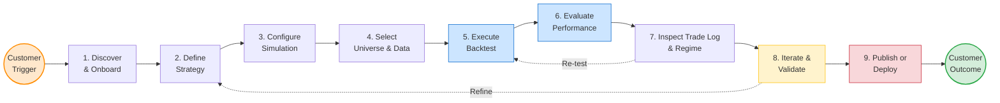
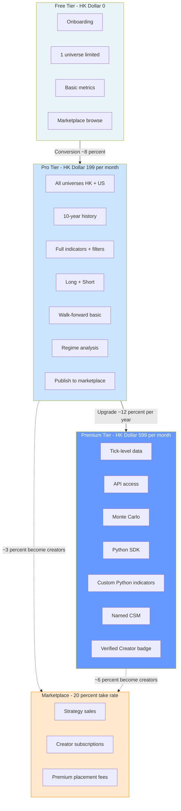

# Value Stream — Retail Backtesting Fintech SaaS

> **Companion docs:** [CONCEPT.md](./CONCEPT.md) · [STRATEGY_DEFINITION.md](./STRATEGY_DEFINITION.md) · [BUSINESS_CANVAS.md](./BUSINESS_CANVAS.md) · [FSM_ARCHITECTURE.md](./FSM_ARCHITECTURE.md)
>
> **Framework:** BIZBOK-aligned Value Stream Mapping — every stage defines Participants, Entrance Criteria, Exit Criteria, Value Items Produced, and Willingness-to-Pay Items, with banking-industry rigor.
>
> **Customer trigger:** _"I have a trading idea I want to validate"_ — or — _"I want to learn whether systematic investing actually works"_
>
> **Customer outcome:** _"I have a strategy I trust enough to commit real capital — and an audit trail to prove it."_

---

## 1. Value Stream at a Glance

Each downstream stage is **gated** by the prior stage's exit criteria. Iteration loops (S7→S5, S8→S2) are the primary mechanism by which a strategy graduates from idea to deployment-grade.

---

## 2. Value Stream Stages — Detailed

For each stage: **Participants** (who is involved), **Entrance Criteria** (what must be true to enter), **Exit Criteria** (what must be true to exit), **Value Items Produced** (what the stage creates), and **Willingness-to-Pay Items** (what retail customers will pay for, by tier).

---

### Stage 1 — Discover & Onboard

The customer becomes aware of the platform, signs up, completes onboarding, and produces their first backtest.

| Aspect | Detail |
|---|---|
| **Participants** | Prospect · Marketing channels (KOL, SEO, broker deep-link) · Onboarding system · Strategy template library |
| **Entrance Criteria** | Prospect has an investing question they want answered, OR has been referred from a KOL / broker / community |
| **Exit Criteria** | Account created · First strategy template loaded · First backtest run successfully · Result screen viewed |
| **Value Items Produced** | (a) Frictionless signup (<2 min) · (b) "I ran my first backtest in 5 minutes" wow moment · (c) Working baseline strategy in their workspace · (d) Marketplace browse access |
| **WTP — Tier 1 Free** | This stage is the conversion funnel; Free tier is the WTP for value items here |
| **WTP — Tier 2 Pro** | Pays HK$199/mo to unlock all universes during this stage instead of being limited to one |
| **WTP — Tier 3 Premium** | Pays HK$599/mo for white-glove onboarding + named CSM walkthrough |

---

### Stage 2 — Define Strategy

The customer translates an idea into a machine-readable strategy using one of three editing modes (no-code form, low-code block editor, full-code Python SDK) — all backed by the single strategy schema in [STRATEGY_DEFINITION.md §7](./STRATEGY_DEFINITION.md).

| Aspect | Detail |
|---|---|
| **Participants** | Customer · Strategy schema engine · Indicator library · Template marketplace · (optional) Strategy purchased from marketplace |
| **Entrance Criteria** | Customer has an investing idea OR has chosen a marketplace strategy to clone OR is iterating on a previous strategy |
| **Exit Criteria** | All seven schema layers (Universe, Signal, Entry, Sizing, Exit, Costs, Schema-version) are populated · Strategy passes static validation (no contradictions, no missing parameters) |
| **Value Items Produced** | (a) Validated machine-readable strategy object · (b) Auto-generated risk disclosure ("this is what your rules mean") · (c) Schema version pin for reproducibility · (d) Ability to switch between no-code/low-code/full-code views |
| **WTP — Tier 1 Free** | Free: basic indicator library, single market, no fundamental filters |
| **WTP — Tier 2 Pro** | HK$199/mo for: full fundamental filter library, all 30+ technical indicators, pattern recognition, factor ranking, multi-direction long+short, ATR-based sizing |
| **WTP — Tier 3 Premium** | HK$599/mo for: Python SDK with custom indicator authoring, schema export/versioning for institutional audit, multi-leg / pairs strategies |

---

### Stage 3 — Configure Simulation

Set the simulation boundaries: backtest date range, starting capital, execution cost model, commission model, slippage model. Per [CONCEPT.md §HOW.2](./CONCEPT.md), these inputs determine every output metric.

| Aspect | Detail |
|---|---|
| **Participants** | Customer · Cost model engine · Calendar / corporate-action data service |
| **Entrance Criteria** | Strategy object is valid (passed Stage 2 exit) |
| **Exit Criteria** | Date range bounded · Starting capital set (default HK$100K) · Commission model selected (%/fixed/per-share) · Slippage model selected (%/fixed/ATR-based) · Short borrow cost defined if short-enabled |
| **Value Items Produced** | (a) Realistic cost-of-trading assumption baked in · (b) Reproducible run parameters · (c) Corporate-actions-aware date range (splits, dividends, halts respected) |
| **WTP — Tier 1 Free** | Limited to 1-year history, fixed commission model only |
| **WTP — Tier 2 Pro** | HK$199/mo for: 10-year history, ATR-based slippage, custom commission rates, short-side enabled |
| **WTP — Tier 3 Premium** | HK$599/mo for: 20+ year history, tick-level cost modeling, custom corporate-action handling rules |

---

### Stage 4 — Select Universe & Data

Apply universe selection (Single Stock, Watchlist, Screener, Index, Custom) and liquidity pre-filters. This stage delivers the single most important technical differentiator: **point-in-time, survivorship-bias-free data** (per [CONCEPT.md §Pitfalls — Survivorship Bias](./CONCEPT.md)).

| Aspect | Detail |
|---|---|
| **Participants** | Customer · Point-in-time universe service · Liquidity filter engine · Factor ranking system · External data partners (HKEX, Refinitiv, Polygon) |
| **Entrance Criteria** | Strategy and simulation parameters valid |
| **Exit Criteria** | Universe materialized for every date in backtest window · Liquidity filter applied per [STRATEGY_DEFINITION.md §1.4](./STRATEGY_DEFINITION.md) · Delisted/suspended stocks correctly included for historical dates · Universe size logged |
| **Value Items Produced** | (a) Survivorship-bias-free historical universe — **this alone is the moat** · (b) Point-in-time fundamental data keyed to filing release date · (c) Index reconstitution history · (d) Liquidity-aware tradability filter |
| **WTP — Tier 1 Free** | One universe (e.g. Hang Seng OR S&P 500), no point-in-time fundamentals |
| **WTP — Tier 2 Pro** | HK$199/mo for: all named universes (HK + US), full point-in-time fundamentals, screener-driven dynamic universes |
| **WTP — Tier 3 Premium** | HK$599/mo for: tick-level data, sector + GICS-level universes, alternative data (sentiment, supply chain), 20-year point-in-time fundamentals |

---

### Stage 5 — Execute Backtest

The engine iterates bar-by-bar through historical data in strict chronological order, applying entry/exit rules, costs, and slippage per [CONCEPT.md §HOW.4](./CONCEPT.md). **No future data is ever visible during this pass.** The engine itself is implemented per [FSM_ARCHITECTURE.md](./FSM_ARCHITECTURE.md).

| Aspect | Detail |
|---|---|
| **Participants** | Backtest engine (FSM core) · Compute orchestrator · Result persistence layer · Real-time progress channel |
| **Entrance Criteria** | All upstream stages valid · Compute quota available for tier |
| **Exit Criteria** | Engine completes without error · Every bar processed · Every fill recorded · Equity curve materialized · Result persisted with input-hash for reproducibility |
| **Value Items Produced** | (a) Deterministic, reproducible result · (b) Equity curve · (c) Trade log with every fill · (d) Per-bar portfolio snapshots · (e) Input-hash + schema-version audit trail |
| **WTP — Tier 1 Free** | 3 concurrent backtests/day, daily resolution only |
| **WTP — Tier 2 Pro** | HK$199/mo for: unlimited backtests, intraday resolution (hourly, 15-min), parallel runs |
| **WTP — Tier 3 Premium** | HK$599/mo for: priority compute queue, tick-level execution, large-universe runs (>1,000 tickers), API-triggered runs |

---

### Stage 6 — Evaluate Performance

The engine produces the comprehensive metric battery per [CONCEPT.md §HOW.5](./CONCEPT.md): return, risk, risk-adjusted, and trade-quality metrics. The single biggest perceived-value moment for the customer.

| Aspect | Detail |
|---|---|
| **Participants** | Metrics engine · Visualization layer · Benchmark service · Export service |
| **Entrance Criteria** | Backtest run completed |
| **Exit Criteria** | All four metric dimensions computed: return (Total Return, CAGR, Alpha) · risk (Max Drawdown, Volatility, Beta) · risk-adjusted (Sharpe, Sortino, Calmar) · trade quality (Win Rate, Profit Factor, Payoff) · Benchmark comparison rendered · Long-side / short-side metrics broken out separately if applicable |
| **Value Items Produced** | (a) Institutional-grade metrics at retail price · (b) Side-by-side benchmark comparison · (c) Exportable performance report (PDF, CSV) · (d) Shareable result link with audit hash |
| **WTP — Tier 1 Free** | Total Return, CAGR, Max Drawdown, Win Rate only |
| **WTP — Tier 2 Pro** | HK$199/mo for: full metric battery (Sharpe, Sortino, Calmar, Profit Factor, Payoff Ratio, Volatility, Beta, Alpha, etc.) + benchmark overlay |
| **WTP — Tier 3 Premium** | HK$599/mo for: PDF/CSV export with watermark + audit hash for advisor/family-council presentations, custom metric definition |

---

### Stage 7 — Inspect Trade Log & Regime

The customer drills into the trade log (every round-trip with exit reason) and the regime breakdown (per [CONCEPT.md §HOW.7](./CONCEPT.md)). This is where _real_ understanding of strategy behavior emerges and where the platform's analytical depth becomes visible.

| Aspect | Detail |
|---|---|
| **Participants** | Customer · Trade log analyzer · Regime classification service · Market regime data partner |
| **Entrance Criteria** | Backtest result available |
| **Exit Criteria** | Every trade row inspectable with: symbol, direction, entry/exit dates+prices, qty, commission, slippage, net P&L, %, holding days, exit reason · Regime-tagged performance available (Bull/Bear, High/Low Vol, Risk-On/Off, Inflation Shock, Rate Cycle) · Exit-reason distribution chart visible |
| **Value Items Produced** | (a) Trade-level transparency · (b) Exit-reason taxonomy (TP / SL / Trailing / Time / Signal) reveals what's driving returns · (c) Regime breakdown reveals hidden dependencies · (d) Per-symbol contribution breakdown |
| **WTP — Tier 1 Free** | Trade log only (no regime breakdown) |
| **WTP — Tier 2 Pro** | HK$199/mo for: full regime analysis, exit-reason analytics, per-symbol attribution, factor exposure analysis |
| **WTP — Tier 3 Premium** | HK$599/mo for: custom regime definitions, macro overlay (Fed funds, HIBOR, USD/HKD), event studies |

---

### Stage 8 — Iterate & Validate

A single backtest is never the conclusion. This stage covers walk-forward analysis, out-of-sample testing, parameter sensitivity, and Monte Carlo simulation per [CONCEPT.md §HOW.8](./CONCEPT.md). This is the difference between a strategy that "looked good once" and one worth deploying.

| Aspect | Detail |
|---|---|
| **Participants** | Customer · Walk-forward engine · Parameter sweep service · Monte Carlo engine · Overfit detector |
| **Entrance Criteria** | Stage 6/7 result available · Customer suspects (or wants to prove) the strategy isn't overfit |
| **Exit Criteria** | Walk-forward pass executed across rolling windows · Out-of-sample test on held-back period executed · Parameter sensitivity chart generated · Overfit score computed and disclosed |
| **Value Items Produced** | (a) Walk-forward validation report — _the actual proof of robustness_ · (b) Parameter sensitivity heatmap · (c) Out-of-sample comparison · (d) Monte Carlo equity curve fan · (e) Overfit warning if degree-of-freedom is too high for sample size |
| **WTP — Tier 1 Free** | Not available |
| **WTP — Tier 2 Pro** | HK$199/mo for: walk-forward (basic), out-of-sample split, parameter sweep |
| **WTP — Tier 3 Premium** | HK$599/mo for: Monte Carlo simulation, nested walk-forward, advanced overfit detection (Deflated Sharpe, PBO), institutional-grade validation report |

---

### Stage 9 — Publish or Deploy

The terminal stage. The customer either publishes the validated strategy to the marketplace, exports it to a broker for live deployment, or saves it as a personal portfolio rule.

| Aspect | Detail |
|---|---|
| **Participants** | Customer · Marketplace service · Compliance gate · Broker integration · Export service · Reputation scoring |
| **Entrance Criteria** | Strategy passes walk-forward / out-of-sample validation · Audit trail complete · For marketplace listing: compliance check passed |
| **Exit Criteria** | One of: (a) Strategy listed on marketplace with reproducible audit hash · (b) Strategy deployed via broker deep-link (Futu / Tiger / IBKR) · (c) Strategy saved as private portfolio rule with scheduled re-run |
| **Value Items Produced** | (a) Marketplace listing with **compliance-grade audit trail** (every backtest reproducible, version-pinned, data-hash recorded) · (b) Broker deployment with one-click intent · (c) Recurring backtest schedule (e.g. monthly re-validation) · (d) Reputation entry for creator |
| **WTP — Tier 1 Free** | Browse and copy marketplace strategies, deploy via broker deep-link |
| **WTP — Tier 2 Pro** | HK$199/mo + 20% marketplace take · Publish to marketplace, earn revshare on copies/subscribers · API webhooks for re-run alerts |
| **WTP — Tier 3 Premium** | HK$599/mo + 20% marketplace take · Premium listing placement · Verified-creator badge · Multi-broker deployment · Co-branded reports for family councils / advisors |

---

## 3. The Willingness-to-Pay Matrix

This is the master table. Every monetizable value item × tier. Use this as the **pricing rationale** for the pitch deck.

### 3.1 Functional Value Items (what the product _does_)

| # | Value Item | Free | Pro HK$199/mo | Premium HK$599/mo | Marketplace |
|---|---|:---:|:---:|:---:|:---:|
| F1 | Run a backtest | ✓ (3/day, daily) | ✓ unlimited, intraday | ✓ priority, tick-level | — |
| F2 | Multi-market universe (HK + US) | One market only | Both | Both + sector | — |
| F3 | Point-in-time + survivorship-free data | 1-year history | 10-year | 20-year + alt data | — |
| F4 | Fundamental filters (PE, ROIC, Growth) | Basic 3 metrics | Full library | Full + custom | — |
| F5 | Technical indicators | 8 basics | All 30+ | All + custom Python | — |
| F6 | Pattern recognition (Double Top, Breakout, etc.) | — | ✓ | ✓ + custom | — |
| F7 | Factor ranking system | — | ✓ | ✓ + custom weights | — |
| F8 | Long + Short strategies | Long only | Both | Both + pairs trading | — |
| F9 | Walk-forward validation | — | Basic | Nested + advanced | — |
| F10 | Monte Carlo simulation | — | — | ✓ | — |
| F11 | Regime analysis | — | ✓ | ✓ + custom regimes | — |
| F12 | Overfit detection (Deflated Sharpe, PBO) | — | Basic warning | Full | — |
| F13 | API access | — | — | ✓ | — |
| F14 | Tick-resolution data | — | — | ✓ | — |
| F15 | Custom Python SDK | — | — | ✓ | — |

### 3.2 Trust & Risk-Mitigation Value Items (what the product _prevents_)

| # | Value Item | Free | Pro | Premium | Why customer pays |
|---|---|:---:|:---:|:---:|---|
| T1 | Survivorship-bias-free data | ✓ | ✓ | ✓ | Prevents inflated backtest returns. Table stakes — table stakes is itself the WTP relative to free competitors who don't deliver this. |
| T2 | Look-ahead bias prevention (engine) | ✓ | ✓ | ✓ | Engine enforces strict chronological pass. Trust foundation. |
| T3 | Point-in-time fundamentals | — | ✓ | ✓ | The reason a serious customer leaves TradingView. |
| T4 | Reproducible audit trail (input hash) | Basic | ✓ | ✓ + signed | Required for advisor/family council, marketplace listing, regulatory documentation. |
| T5 | Cost-realistic execution (commission + slippage) | Fixed model | All models | Custom + tick-level | Without this, backtests overstate returns. |
| T6 | SFC-aligned risk disclosure templates | ✓ | ✓ | ✓ + customizable | HK retail requires this; differentiates from US-only products. |
| T7 | Overfit warning at strategy validation | Basic | Full | Institutional (Deflated Sharpe, PBO) | Customer's biggest fear: "is this real?" |

### 3.3 Time & Effort Value Items (what the product _saves_)

| # | Value Item | Free | Pro | Premium | Time saved (vs DIY) |
|---|---|:---:|:---:|:---:|---|
| E1 | Pre-built strategy templates | 5 templates | 50+ templates | 50+ + marketplace | 40+ hours of design |
| E2 | No-code → full-code continuum | Form only | Form + block | All three | Eliminates learning Python before testing an idea |
| E3 | One-click marketplace copy + customize | ✓ | ✓ | ✓ | 20+ hours per strategy |
| E4 | Scheduled re-runs (e.g. monthly) | — | ✓ | ✓ + API webhook | Hours per month, every month |
| E5 | Broker deep-link deployment | ✓ | ✓ | ✓ + multi-broker | 30 min per deployment |
| E6 | Export to PDF/CSV with audit hash | — | ✓ | ✓ + signed | Hours of manual formatting |

### 3.4 Emotional & Social Value Items (what the product _feels like_)

| # | Value Item | Free | Pro | Premium | Marketplace |
|---|---|:---:|:---:|:---:|:---:|
| S1 | Community Discord access | ✓ | ✓ | ✓ | ✓ |
| S2 | Public profile / leaderboard | Browse | Participate | Participate + verified badge | Creator profile |
| S3 | "Verified Creator" badge | — | — | ✓ (qualifying) | ✓ |
| S4 | Named CSM (Customer Success Manager) | — | — | ✓ | — |
| S5 | Marketplace revshare on published strategies | — | 80% (20% platform take) | 80% (premium placement) | — |
| S6 | Co-branded report for advisor / family use | — | — | ✓ | — |

---

## 4. What Retail Customers Are Willing to Pay For

The condensed answer to the user's question. Across all tiers, retail customers will pay for these — ranked by WTP elasticity (highest = least price-sensitive):

### Tier A — The "I'll pay almost anything for this" items (highest WTP)

These are the value items where customers will pay materially above marginal cost because the alternative (DIY, or being wrong with real money) is far more expensive.

1. **Survivorship-bias-free, point-in-time data** — recreating this is hundreds of hours of work and tens of thousands of dollars in data licenses. The single biggest WTP driver.
2. **Walk-forward & out-of-sample validation** — the actual proof their strategy isn't overfit. Customers fear false confidence more than they fear a bad backtest.
3. **Institutional-grade metrics (Sharpe / Sortino / Calmar / Profit Factor / Max DD)** — needed to converse credibly with advisors, family, or themselves.
4. **Reproducible audit trail** — required for Tier 3 customers presenting to family councils or RIAs; required for marketplace listings to be trusted.
5. **Regime analysis** — reveals the strategy isn't just riding one bull market. Distinguishes "real edge" from "lucky era."

### Tier B — The "I'll pay because it makes me better, faster" items (medium-high WTP)

6. **No-code → low-code → full-code continuum** — meets the customer where they are; grows with them.
7. **Pre-built strategy templates + marketplace** — saves 40+ hours per strategy; copying a vetted template is faster than designing.
8. **Multi-market (HK + US) at parity** — most competitors are US-only; HK retail will pay for first-class HK support.
9. **Broker integration / deep-link deployment** — closes the loop from backtest to live trading.
10. **Realistic execution model (commission + slippage + short borrow)** — prevents the "$100K backtest profit becomes $5K live" trap.

### Tier C — The "I'll pay for the upgrade tier" items (Premium-tier WTP)

11. **Tick-resolution data** — needed for intraday strategies; expensive to license, so commands premium pricing.
12. **API access** — Tier 3 power users want programmatic control.
13. **Monte Carlo simulation** — institutional-grade statistical rigor.
14. **Custom Python SDK / custom indicators** — for the quant-adjacent retail user who outgrew low-code.
15. **Named CSM + co-branded reports** — Tier 3 white-glove experience.

### Tier D — The "I'll pay transaction fees" items (marketplace WTP)

16. **Marketplace strategy purchases** — Tier 1 / Tier 2 will pay one-time or subscription fees to copy validated strategies.
17. **Marketplace creator subscriptions** — pay a successful creator monthly for their evolving strategy stream.
18. **Premium marketplace listing placement** — creators pay to be featured.
19. **Verified-creator badge** — earns trust premium on creator pricing.

### Tier E — The "I won't pay extra but I'll switch for it" items (table-stakes WTP)

These don't independently drive paid conversion but are required to be paid-eligible at all:

20. **Survivorship-bias prevention** (already in Tier A — but worth restating: this is BOTH the highest WTP item AND a table-stakes item; absence of it kills any sale).
21. **Look-ahead bias prevention** — built into engine.
22. **SFC-aligned risk disclosures** — required for HK launch.
23. **Mobile companion** — expected as part of any modern SaaS.
24. **Discord community access** — expected; absence is felt.

---

## 5. WTP × Tier × Value Stream Stage — Pricing Justification

A pricing economist's view: each tier's price must be justified by the value items it unlocks. This table maps the **monthly fee** to the **stages where value is unlocked**.

---

## 6. Value Items vs Customer Pains (Why Each WTP Item Exists)

Every WTP item should map to an underlying customer pain. If it doesn't, it's an unjustified line item.

| Customer Pain | Value Item That Addresses It | Tier |
|---|---|---|
| "My backtest looks great but I'm scared it's overfit" | Walk-forward, out-of-sample, Monte Carlo, Deflated Sharpe | Pro / Premium |
| "I don't trust the data — what about delisted stocks?" | Survivorship-bias-free universe, point-in-time membership | All paid tiers |
| "TradingView is too simple, QuantConnect is too codey" | No-code → low-code → full-code continuum | All tiers |
| "I want to test HK and US, but every product treats HK as an afterthought" | HK + US parity, HKD pricing, Cantonese UI, FPS payment | All paid tiers |
| "I need to convince my family to approve this allocation" | Audit-trail PDF report, regime analysis, walk-forward proof | Premium |
| "I don't have time to design strategies from scratch" | Marketplace + 50+ templates + creator subscriptions | All tiers |
| "I make money in bull markets and lose it in bear markets" | Regime analysis, market-state-tagged performance | Pro / Premium |
| "I want to deploy this strategy to my broker without copy-paste" | Futu / Tiger / IBKR deep-link integration | All tiers |
| "I'm a quant developer — give me a real API" | Python SDK, REST API, webhooks | Premium |
| "I just want to learn — but I want to learn the right way" | In-product courses, guided templates, community | Free |
| "I built a great strategy — can I make money sharing it?" | Marketplace creator program, 80% revshare | Pro / Premium |
| "I need a compliance disclosure on this strategy" | SFC-aligned templates, "past performance" warnings | All tiers |
| "I lose backtest results in spreadsheets — I can't reproduce them later" | Reproducible audit trail with input hash + schema version | All paid tiers |

---

## 7. Bottlenecks & Value Leakage (Operational View)

For the enterprise-architect lens — where in the value stream does value leak and how do we measure it?

| Stage | Common Leakage | Measurement | Mitigation |
|---|---|---|---|
| 1. Discover & Onboard | Signup drops after credit card prompt | Funnel conversion, time-to-first-backtest | Free tier requires no card; templates pre-loaded |
| 2. Define Strategy | Customer abandons before completing 7 layers | Stage 2 → Stage 3 progression rate | Wizards, defaults, marketplace copy-paste |
| 4. Select Universe | Customer doesn't know what universe to choose | Default selection rate vs custom | Smart defaults based on strategy idea |
| 5. Execute Backtest | Compute queue delays in peak hours | P50/P95 backtest latency | Tier-based compute quotas, priority queues |
| 6. Evaluate Performance | Customer doesn't understand which metrics matter | Time on page, metric tooltips engagement | Guided result tour, "what to look at first" |
| 7. Trade Log & Regime | Customer never opens regime view | Click rate on regime tab | Surface regime score in main result summary |
| 8. Iterate & Validate | Customer ships without walk-forward | % of deployed strategies that ran walk-forward | Gate "Publish to marketplace" on walk-forward pass |
| 9. Publish or Deploy | Customer copies result but doesn't deploy | Backtest → live deployment conversion | One-click broker integration |

---

## 8. Cross-Reference — Where Each Stage Anchors

| Stage | Anchored In |
|---|---|
| 1. Discover & Onboard | [BUSINESS_CANVAS.md §4 Channels](./BUSINESS_CANVAS.md) |
| 2. Define Strategy | [STRATEGY_DEFINITION.md §1–7](./STRATEGY_DEFINITION.md) |
| 3. Configure Simulation | [CONCEPT.md §HOW.2](./CONCEPT.md) + [STRATEGY_DEFINITION.md §3.3, §3.4](./STRATEGY_DEFINITION.md) |
| 4. Select Universe & Data | [STRATEGY_DEFINITION.md §1.1–1.6](./STRATEGY_DEFINITION.md) + [CONCEPT.md §Pitfalls — Survivorship Bias](./CONCEPT.md) |
| 5. Execute Backtest | [CONCEPT.md §HOW.4](./CONCEPT.md) + [FSM_ARCHITECTURE.md](./FSM_ARCHITECTURE.md) |
| 6. Evaluate Performance | [CONCEPT.md §HOW.5](./CONCEPT.md) |
| 7. Trade Log & Regime | [CONCEPT.md §HOW.6, §HOW.7](./CONCEPT.md) |
| 8. Iterate & Validate | [CONCEPT.md §HOW.8](./CONCEPT.md) + [STRATEGY_DEFINITION.md §7](./STRATEGY_DEFINITION.md) |
| 9. Publish or Deploy | [BUSINESS_CANVAS.md §6 Revenue Streams (marketplace)](./BUSINESS_CANVAS.md) |

---

## 9. One-Slide Summary (for Pitch Deck)

> **The Value Stream:** Customer enters with "I have a trading idea." Nine gated stages move them to "I have a validated, reproducible, deployment-grade strategy" — with checkable exit criteria at every step.
>
> **The WTP Stack:** Customers pay most for items that prevent expensive errors (survivorship-bias-free data, walk-forward validation, regime analysis), save material time (templates, marketplace, no-code-to-full-code), and unlock institutional-grade credibility (audit trail, Sharpe/Sortino/Calmar, advisor-ready reports).
>
> **The Tier Logic:** Free unlocks Stages 1–6 at limited scale. Pro (HK$199) unlocks the depth of Stages 2–7 plus Stage 8 basics. Premium (HK$599) unlocks Stage 8 institutional rigor + Stage 9 deployment power. Marketplace monetizes Stage 9 at 20% take.
>
> **The Moat:** No competitor in HK delivers Stages 4 (point-in-time data) and 8 (walk-forward + Monte Carlo) together at retail price. That gap is the wedge.
